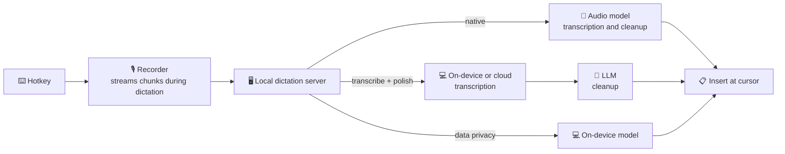

<p align="center">
  
</p>

<h1 align="center">SpeakMore</h1>

<p align="center">
  <b>Speak more. Type less.</b><br>
  Free, open-source voice dictation for macOS and Windows.<br>
  Works with leading AI models, or entirely on device.<br>
  <a href="https://speakmore.zephyrxiang.com">speakmore.zephyrxiang.com</a>
</p>

<p align="center">
  
  
  
  <a href="LICENSE"></a>
</p>

<p align="center">
  <a href="README.md">简体中文</a> · <b>English</b>
</p>

<p align="center">
  
</p>

<picture>
  <source media="(prefers-color-scheme: dark)" srcset="https://media.speakmore.zephyrxiang.com/readme/home-dark.en.d337323a.webp" />
  
</picture>

Press the hotkey to start dictating and press it again to finish; the text is inserted at the cursor. In the Native and Transcribe + Polish modes, filler words, repetitions and self-corrections are removed, punctuation is added, and longer passages are split into paragraphs and lists.

## Five freedoms

<table>
  <tr>
    <td align="center">🧩</td>
    <td><a href="#-model-freedom"><b>Model freedom</b></a></td>
    <td>29 models from Gemini, OpenAI, Qwen, DeepSeek, Kimi, Zhipu GLM and MiniMax, plus any OpenAI-compatible service. Existing API keys work as they are.</td>
  </tr>
  <tr>
    <td align="center">🔀</td>
    <td><a href="#-mode-freedom"><b>Mode freedom</b></a></td>
    <td>Three recognition modes of equal standing: Native, Transcribe + Polish, and Data Privacy. Recommended setups are enabled in one click.</td>
  </tr>
  <tr>
    <td align="center">💻</td>
    <td><a href="#-hardware-freedom"><b>Hardware freedom</b></a></td>
    <td>Macs with Apple silicon or Intel, and Windows. On-device models run on Metal, on Vulkan (NVIDIA, AMD and Intel graphics), or on the CPU.</td>
  </tr>
  <tr>
    <td align="center">🔒</td>
    <td><a href="#-privacy-freedom"><b>Privacy freedom</b></a></td>
    <td>Data Privacy mode transcribes on device and uploads no data. No API key or account is required. On-device models download in one click.</td>
  </tr>
  <tr>
    <td align="center">💸</td>
    <td><a href="#-cost-freedom"><b>Cost freedom</b></a></td>
    <td>The software is free; model usage is billed by each vendor directly. At 100 dictations a day, the recommended setups cost $0 to about $5 per month.</td>
  </tr>
</table>

## 🚀 Installation

<p align="center">
  <a href="https://dl.zephyrxiang.com/speakmore/v0.9.0/SpeakMore-arm64.dmg"></a>
  <a href="https://dl.zephyrxiang.com/speakmore/v0.9.0/SpeakMore-x64.dmg"></a>
  <a href="https://dl.zephyrxiang.com/speakmore/v0.9.0/SpeakMore-Setup-x64.exe"></a>
</p>

| Platform | Requirements | Installation |
| --- | --- | --- |
| **macOS** | macOS 12 or later | Open the dmg and drag SpeakMore into Applications. The package is signed with a Developer ID and notarized by Apple. |
| **Windows** | Windows 10 (1809 or later) or Windows 11, 64-bit | Run the installer. If "Windows protected your PC" appears, select **More info**, then **Run anyway**. Installation is per user, requires no administrator rights and no network connection. |

A terminal installation is also available and adds the `speakmore` command-line tool:

```bash
# macOS
curl -fsSL https://dl.zephyrxiang.com/speakmore/install.sh | bash
```

```powershell
# Windows (PowerShell)
irm https://dl.zephyrxiang.com/speakmore/install.ps1 | iex
```

Append `.sha256` to any download link to obtain its checksum.

<details>
<summary><b>Installer and terminal installation compared</b></summary>

The installer provides a standalone app: macOS permissions are granted to SpeakMore itself, and it can open at login. The terminal installation on macOS runs from the terminal, and permissions are granted to that terminal. On Windows, both methods install the same files into `%USERPROFILE%\.speakmore` and add a Start menu entry. Both share settings, history and the `speakmore` command; run only one at a time.

</details>

## 🎙️ Usage

1. Place the cursor in any text field and press **Right Option** (**Right Alt** on Windows).
2. Dictate. The bar at the bottom of the screen follows the input level.
3. Press the hotkey again to insert the text at the cursor, or press `esc` to discard the dictation.

SpeakMore resides in the menu bar (the notification area on Windows). The main window provides statistics, history, models and settings.

### Onboarding

On first launch, an onboarding flow guides the configuration. Every step supports going back and forward and can be skipped; skipped items can be completed later in the main window. Data Privacy mode requires no API key.

<table>
  <tr>
    <td width="50%"></td>
    <td width="50%"></td>
  </tr>
  <tr>
    <td align="center"><sub><b>1</b> · Select a recognition mode</sub></td>
    <td align="center"><sub><b>2</b> · Configure an API key (optional)</sub></td>
  </tr>
  <tr>
    <td></td>
    <td></td>
  </tr>
  <tr>
    <td align="center"><sub><b>3</b> · Download an on-device model in the background</sub></td>
    <td align="center"><sub><b>4</b> · Grant system permissions</sub></td>
  </tr>
  <tr>
    <td></td>
    <td></td>
  </tr>
  <tr>
    <td align="center"><sub><b>5</b> · Test the microphone</sub></td>
    <td align="center"><sub><b>6</b> · Test the hotkey</sub></td>
  </tr>
  <tr>
    <td></td>
    <td></td>
  </tr>
  <tr>
    <td align="center"><sub><b>7</b> · Dictation test</sub></td>
    <td align="center"><sub><b>8</b> · Setup complete</sub></td>
  </tr>
</table>

## 🧩 Model freedom

<picture>
  <source media="(prefers-color-scheme: dark)" srcset="https://media.speakmore.zephyrxiang.com/readme/vendors-dark.en.51093b18.webp" />
  
</picture>

<sub>All names and logos are the property of their respective owners and are shown solely to indicate supported services.</sub>

The **Models** page lists every model by role: **7 native** models (audio in, text out), **10 transcription** models (4 on-device, 6 cloud) and **12 polishing** models, each with list prices and measured scores. A model offered by several platforms appears as a single row with a choice of channel.

API keys are managed per platform. A single Alibaba Cloud Bailian key provides access to 14 models; official DeepSeek, Kimi, Zhipu, MiniMax, Gemini and OpenAI keys are supported directly; any OpenAI-compatible service connects with an endpoint address and a key.

<table>
  <tr>
    <td width="50%"></td>
    <td width="50%"></td>
  </tr>
  <tr>
    <td align="center"><sub>All models and channels</sub></td>
    <td align="center"><sub>Keys managed per platform</sub></td>
  </tr>
</table>

## 🔀 Mode freedom

SpeakMore offers three recognition modes. Each mode keeps its own model configuration, so switching requires no reconfiguration.

| Mode | Pipeline | Data uploaded | API key |
| --- | --- | --- | --- |
| ✨ **Native** | Audio → Gemini, OpenAI or Qwen-Omni → finished text, in a single request | The recording, to the selected vendor only | Required |
| 🪄 **Transcribe + Polish** | Audio → on-device or cloud transcription → LLM polishing | With on-device transcription, text only | Required |
| 🛡️ **Data Privacy** | Audio → on-device model → text | None | Not required |

<table>
  <tr>
    <td width="50%"></td>
    <td width="50%"></td>
  </tr>
  <tr>
    <td align="center"><sub>Mode selection on the home window</sub></td>
    <td align="center"><sub>Recommended setups</sub></td>
  </tr>
</table>

**Recommended setups** package a complete pipeline that can be checked before it is enabled; missing keys and on-device models are completed in place.

| Setup | Pipeline | Monthly cost¹ |
| --- | --- | --- |
| On-device + DeepSeek | On-device Qwen3-ASR 0.6B → DeepSeek V4.1 Flash | **≈ $0.39** |
| Gemini Native | Gemini 3.6 Flash | ≈ $5.29 |
| Bailian Cloud | Qwen3 ASR Flash → DeepSeek V4.1 Flash, single key | ≈ $3.02 |
| Fully On-device | Qwen3-ASR 0.6B, no data uploaded | **$0** |

<sub>¹ Based on 100 dictations a day over 30 days; per-dictation usage is the average of 97 real dictations (26 seconds); prices are each vendor's list prices. The app computes the same figure in real time from its price list. On Intel Macs, the recommended setups use the CPU build of SenseVoice Small.</sub>

## 💻 Hardware freedom

The same on-device models run on every supported device. An available graphics card is used first, with automatic fallback to the CPU.

| Device | Acceleration | Qwen3-ASR 0.6B, per dictation² |
| --- | --- | --- |
| Mac with Apple silicon | Metal | **231 ms**, 68× real time |
| Windows with a graphics card (NVIDIA, AMD, Intel) | Vulkan | **240 ms**, 73× real time (RTX 4060 Ti) |
| Any Mac or PC | CPU | SenseVoice Small: 145 ms (Apple silicon), 463 ms (Core i5-13400F) |

<sub>² Median transcription time across 97 real dictations; see Benchmarks below.</sub>


## 🔒 Privacy freedom

- **No data leaves the device in Data Privacy mode.** Speech is transcribed by an on-device model; no API key or account is required.
- **One-click model download.** Models are served from SpeakMore's mirror in mainland China, fall back to Hugging Face automatically, and are verified against SHA-256. The default 850 MB model downloads in about 1.5 minutes.
- **No intermediary servers.** SpeakMore operates no servers and collects no analytics; audio or text is sent directly to the selected vendor with the user's own key.
- **Encrypted key storage.** Keys are protected by the macOS Keychain or Windows DPAPI; history and recordings remain on the local machine.

<picture>
  <source media="(prefers-color-scheme: dark)" srcset="https://media.speakmore.zephyrxiang.com/readme/download-speed-dark.en.8b4db543.webp" />
  
</picture>

## 💸 Cost freedom

SpeakMore is free. Model usage is billed directly by each vendor according to actual use, and the home window itemizes all spending. The table compares heavy use (100 dictations a day) with every Typeless plan:

| | Monthly | Annual | Words | Destination of voice data | Account |
| --- | --- | --- | --- | --- | --- |
| Typeless Free | $0 | $0 | Weekly limit | Typeless servers³ | Required |
| Typeless Pro, billed annually | $12 | $144 | Unlimited | Typeless servers³ | Required |
| Typeless Pro, billed monthly | $30 | $360 | Unlimited | Typeless servers³ | Required |
| Typeless Enterprise | On request | | Unlimited | Typeless servers³ | Required, SSO available |
| **SpeakMore · Fully On-device** | **$0** | **$0** | Unlimited | **Stays on device** | **Not required** |
| **SpeakMore · On-device + DeepSeek** | **≈ $0.39** | **≈ $4.70** | Unlimited | Text only, to DeepSeek | **Not required** |
| **SpeakMore · Bailian Cloud** | **≈ $3.02** | **≈ $36** | Unlimited | Alibaba Cloud Bailian | **Not required** |
| **SpeakMore · Gemini Native** | **≈ $5.29** | **≈ $63** | Unlimited | Google | **Not required** |

<sub>Typeless prices from <a href="https://www.typeless.com/pricing">typeless.com/pricing</a>, retrieved 2026-10-17. SpeakMore estimates follow the method of the setups table above, at vendor list prices as of 2026-10-17; usage within Gemini's free tier incurs no cost.<br>
³ Together with the active application, window title and on-screen text; see the <a href="targets/typeless/docs/06-context-capture-and-privacy.md">reverse-engineering notes</a> (Chinese).</sub>

## 📊 Benchmarks

The default prompt was tuned on 60 real recordings, each compared with the Typeless output for the same audio. On-device models were evaluated on 97 real dictations (42.5 minutes in total, covering Chinese, mixed Chinese–English and English), scored 0–5 against the Native mode output using a fixed rubric.

<details>
<summary><b>On-device transcription: Apple silicon and Windows</b></summary>

| Model | Mac (Apple silicon) | Windows (i5-13400F, RTX 4060 Ti) | Score | Size |
| --- | --- | --- | --- | --- |
| `qwen3-asr-0.6b-q8` (default) | Metal · 231 ms · 68× | Vulkan · 240 ms · 73× | 4.14–4.16 | 850 MB |
| `sensevoice-small-q8` | Metal · 73 ms · 226× | Vulkan · 107 ms · 186× | 3.94 | 253 MB |
| `qwen3-asr-0.6b-int8` | CPU · 1081 ms · 15× | CPU · 3388 ms · 5× | 4.02–4.06 | 987 MB |
| `sensevoice-small-int8` | CPU · 145 ms · 107× | CPU · 463 ms · 37× | 3.75–3.78 | 237 MB |

Times are medians per dictation; the multiplier is audio duration divided by processing time. By language, Qwen3-ASR scores 4.32 on Chinese and 4.02 on mixed Chinese–English; SenseVoice scores 4.38 on Chinese. Full results: [Apple silicon](bench/results/asr-round1-2026-10-16.md), [Windows](bench/results/asr-windows-2026-10-17.md) (Chinese).

</details>

<details>
<summary><b>End to end: Transcribe + Polish on Apple silicon</b></summary>

From hotkey release to text on screen: **1.2–1.75 seconds**, of which transcription takes under 0.7 seconds and the remainder is the polishing request. With prompt caching, one DeepSeek polishing request costs about $0.00004. See the [measurements](bench/results/e2e-local-2026-10-16.md) (Chinese).

</details>

The benchmark harness resides in [`bench/`](bench/README.md); adding a model runs only that model's column.

## ✅ Trust

- **Open source**: MIT-licensed; all code that handles voice data is public.
- **No account**: no registration or sign-in.
- **Single directory**: data, settings, keys, models and logs are stored in `~/.speakmore` (`%USERPROFILE%\.speakmore` on Windows); `speakmore uninstall` removes everything.
- **Signed and verifiable**: the Mac app is signed and notarized, and every package has a SHA-256 checksum.
- **Reverse-engineered, then independently implemented**: the Typeless client is documented in [18 notes](targets/typeless/docs/00-overview.md) (Chinese); SpeakMore was written from scratch to match its interaction and contains no Typeless code or keys.

## 🧑‍💻 For developers

- **Feature parity between CLI and app**: switch modes and models, manage and check keys, download models, query history and spending; `status`, `history` and `usage` support `--json` output.
- **Plug-in architecture**: each vendor is a strategy behind a common interface; audio is normalized to 16 kHz mono, and every transcriber returns `{ text }`.
- **Cross-platform development**: [`scripts/dev/win-*.sh`](scripts/dev) synchronize the working tree to a Windows machine over SSH, run tests remotely, restart the app from source with a debugging port, and capture the desktop.
- **Automated testing**: 939 unit tests and 19 installation tests, plus Biome linting and gates on interface sizing, typography and copy; `npm run check` runs all checks.

```bash
git clone https://github.com/zephyr4123/speakmore.git && cd speakmore
npm install
npm start          # equivalent to the speakmore command
npm run check      # lint and all tests
```



Project layout, packaging, release process and per-version verification records are documented in the [development notes](docs/development.md) and [implementation notes](docs/implementation-notes.md) (Chinese).

## 📚 Reference

<details>
<summary><b>⌨️ Commands</b></summary>

| Command | Description |
| --- | --- |
| `speakmore` | Start; shows status if already running |
| `speakmore stop` / `restart` | Stop / restart |
| `speakmore status [--json]` | Running state, keys, permissions, and usage for today and in total |
| `speakmore update` | Update to the latest version, including SpeakMore.app; settings, keys, history and recordings are preserved |
| `speakmore history [-n count] [--json]` | History, newest first |
| `speakmore usage [--json]` | Spending, tokens and response times for today, this month and in total, per model |
| `speakmore mode [native\|local\|private]` | Show the three recognition modes / switch immediately. `local` is Transcribe + Polish; `private` is Data Privacy |
| `speakmore model [<provider>[/<model>]]` | Native mode: list providers (`gemini` / `openai` / `bailian`) and key status / switch |
| `speakmore transcriber [<model>]` | Transcription models with size, measured speed and download status / switch |
| `speakmore transcriber download\|cancel\|delete <model>` | Download, cancel or delete an on-device model |
| `speakmore polish [<provider>[/<model>]] [--url <url>]` | Polishing model: `deepseek` / `bailian` / `moonshot` / `zhipu` / `minimax` / `custom` |
| `speakmore model check`, `transcriber check`, `polish check` | Send a minimal request (for on-device models, a sentence read by the system voice) to check connectivity and response time |
| `speakmore key [<provider>]` | Replace a key; accepts piped input: `pbpaste \| speakmore key` (Windows: `Get-Clipboard \| speakmore key`) |
| `speakmore key --forget [<provider>]` | Delete a stored key |
| `speakmore config` / `config set <name> <value>` / `config unset <name>` | Show settings / set a value directly / restore the default |
| `speakmore theme [name]` | List themes / switch immediately |
| `speakmore settings` | Open settings |
| `speakmore logs [-n lines] [-f]` | Show logs |
| `speakmore uninstall [--keep-data]` | Uninstall; lists what will be removed and asks for confirmation |

</details>

<details>
<summary><b>⚙️ Settings</b></summary>

| Name | Default | Values |
| --- | --- | --- |
| `hotkey` | `right_option` (macOS), `right_alt` (Windows) | macOS: `right_option` / `right_command` / `right_control` / `fn`; Windows: `right_alt` / `right_ctrl` |
| `mode` | `native` | `native` / `local` / `private` |
| `model` | `gemini/gemini-3.6-flash` | Native mode model, as `provider/model` |
| `thinking` | `MINIMAL` | Gemini thinking level: `MINIMAL` / `LOW` / `MEDIUM` / `HIGH` |
| `transcriber` | `qwen3-asr-0.6b-q8` | Transcribe + Polish, step 1: an on-device model or a cloud model such as `bailian/qwen3-asr-flash` |
| `privateTranscriber` | `qwen3-asr-0.6b-q8` | On-device model used by Data Privacy mode |
| `polish` | `deepseek/deepseek-flash` | Transcribe + Polish, step 2, as `provider/model`; `custom/<model>` for a self-hosted service |
| `customUrl` | empty | OpenAI-compatible endpoint, e.g. `http://127.0.0.1:11434/v1` |
| `modelSource` | `cn` | On-device model source: `cn` (SpeakMore mirror) / `original` (Hugging Face) |
| `acceleration` | `auto` | `auto` uses the graphics card when available; `cpu` uses the CPU only |
| `barHint` | `on` | Hint line above the voice bar: `on` / `off` |
| `theme` | `ink` | `ink` / `cinnabar` / `indigo` |
| `language` | `system` | `system` / `en` / `zh-CN` |

Settings are stored in `~/.speakmore/settings.json`. Switching through the app or `speakmore mode`, `model`, `transcriber` and `polish` is checked first and takes effect immediately; `config set` writes values directly without checks. For temporary overrides, set environment variables such as `SPEAKMORE_HOTKEY`, `SPEAKMORE_MODE`, `SPEAKMORE_MODEL`, `SPEAKMORE_TRANSCRIBER`, `SPEAKMORE_POLISH`, `SPEAKMORE_THEME` and `SPEAKMORE_LANGUAGE` at startup; `GEMINI_API_KEY`, `OPENAI_API_KEY`, `DEEPSEEK_API_KEY`, `BAILIAN_API_KEY`, `MOONSHOT_API_KEY` (Kimi), `ZHIPU_API_KEY`, `MINIMAX_API_KEY` and `SPEAKMORE_CUSTOM_API_KEY` take precedence over stored keys.

</details>

<details>
<summary><b>💰 Cost accounting</b></summary>

Every model call is recorded with its tokens (including audio and thinking), model, cost and latency. The home window breaks down today, this month and all time by model; on-device transcription appears as a separate, free entry. `speakmore usage` provides further detail.

- Costs are estimates in US dollars at each vendor's list price; platforms priced in yuan are converted at 6.71.
- Gemini's prompt cache bills repeated prompt content at one tenth of the standard price; SpeakMore creates the cache as soon as dictation starts.

</details>

<details>
<summary><b>🔐 Permissions</b></summary>

| macOS permission | Purpose |
| --- | --- |
| Microphone | Recording |
| Input Monitoring | Detecting the hotkey; only that key is monitored and no other input is recorded |
| Accessibility | Inserting text with a simulated ⌘V; responding to `esc` during dictation |

The app requests these permissions during onboarding. With the terminal installation, permissions are granted to the terminal that runs SpeakMore. On Windows, only microphone access is required (Settings › Privacy & security › Microphone).

</details>

<details>
<summary><b>🗂️ File locations</b></summary>

All files are stored in `~/.speakmore/` (`%USERPROFILE%\.speakmore\` on Windows) and are readable only by the current user:

| File | Description |
| --- | --- |
| `settings.json` | Settings |
| `<vendor>-key.bin` | Encrypted keys, one per vendor. The decryption key is held in the Keychain (bound to the account by DPAPI on Windows), so a copied file cannot be decrypted |
| `data/history.db`, `data/Recordings/` | History, recordings and spending records |
| `logs/main.log` | Logs of lengths, timings and usage only; dictated content and keys are never logged |
| `models/` | On-device models, downloaded on request and verified against SHA-256 |
| `bin/`, `app/`, `runtime/` | Program files of the terminal installation |

Outside this directory: the Keychain entry, granted system permissions, and SpeakMore in Applications; on Windows, the Start menu shortcut, a Path entry and the open-at-login entry.

</details>

<details>
<summary><b>🩺 Troubleshooting</b></summary>

| Symptom | Resolution |
| --- | --- |
| A key shows "not verified (couldn't reach … at launch)" | The vendor was unreachable at startup and the stored key is in use; run `speakmore status` once online |
| A check fails although the key is correct | Usually an incorrect model name or thinking level. `speakmore model check` shows the response; `speakmore config unset model` restores the default |
| The hotkey has no effect | `speakmore status` lists missing items; `speakmore restart` restarts the hotkey listener |
| A command reports "SpeakMore didn't reply within 5 seconds" | Run `speakmore stop`, then `speakmore` |
| No menu bar icon | On MacBooks with a notch, surplus icons are hidden behind it. Hold ⌘ and drag some icons out of the menu bar, or run `speakmore settings` |

</details>

<details>
<summary><b>🔄 Updating and uninstalling</b></summary>

- **Update**: `speakmore update` updates both the terminal installation and SpeakMore.app, then reopens whichever was running. For the app alone, download the new dmg and install it over the existing copy. Settings, keys, history and recordings are preserved.
- **Uninstall**: `speakmore uninstall` stops SpeakMore and removes the entire directory, the command and the Keychain entry (on Windows, also the Path entry, Start menu shortcut and open-at-login entry); `--keep-data` preserves settings, keys, history and recordings. For the app alone, quit it from the menu bar and move it to the Trash.

</details>

## License

[MIT](LICENSE). Files under `.claude/skills/` are from [REA](https://github.com/morluto/rea) and are covered by its own MIT license.

The name pays tribute to Typeless. SpeakMore is an independent implementation based on reverse-engineering notes and is not affiliated with Typeless.
