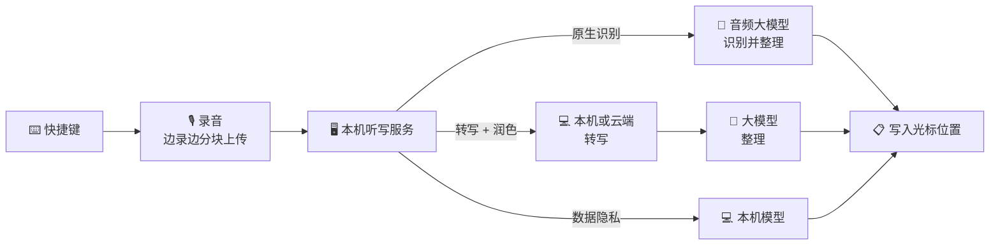

<p align="center">
  
</p>

<h1 align="center">SpeakMore</h1>

<p align="center">
  <b>说话，别打字。</b><br>
  开源、免费的语音输入工具，支持 macOS 与 Windows。<br>
  兼容主流大模型，亦可完全在本机运行。<br>
  <a href="https://speakmore.zephyrxiang.com/?lang=zh-CN">speakmore.zephyrxiang.com</a>
</p>

<p align="center">
  
  
  
  <a href="LICENSE"></a>
</p>

<p align="center">
  <b>简体中文</b> · <a href="README.en.md">English</a>
</p>

<p align="center">
  
</p>

<picture>
  <source media="(prefers-color-scheme: dark)" srcset="https://media.speakmore.zephyrxiang.com/readme/home-dark.zh-CN.ded4c77a.webp?v=4" />
  
</picture>

按下快捷键开始口述，再次按下即结束，文字自动写入当前光标位置。采用原生识别或转写 + 润色方式时，系统自动去除语气词、重复与改口内容，补全标点，并对较长内容分段、分条。

## 五项自由

<table>
  <tr>
    <td align="center">🧩</td>
    <td><a href="#-模型自由"><b>模型自由</b></a></td>
    <td>支持 Gemini、OpenAI、通义千问、DeepSeek、Kimi、智谱 GLM、MiniMax 共 29 个模型，以及任意 OpenAI 兼容服务；沿用已有密钥即可接入。</td>
  </tr>
  <tr>
    <td align="center">🔀</td>
    <td><a href="#-方式自由"><b>方式自由</b></a></td>
    <td>原生识别、转写 + 润色、数据隐私三种识别方式并列可选；推荐组合一键启用。</td>
  </tr>
  <tr>
    <td align="center">💻</td>
    <td><a href="#-硬件自由"><b>硬件自由</b></a></td>
    <td>支持 Apple 芯片与 Intel 的 Mac，以及 Windows；本机模型可经 Metal、Vulkan（NVIDIA、AMD、Intel 显卡）或 CPU 运行。</td>
  </tr>
  <tr>
    <td align="center">🔒</td>
    <td><a href="#-隐私自由"><b>隐私自由</b></a></td>
    <td>数据隐私方式仅在本机转写，不上传任何数据，无需密钥与账号；本机模型一键下载。</td>
  </tr>
  <tr>
    <td align="center">💸</td>
    <td><a href="#-费用自由"><b>费用自由</b></a></td>
    <td>软件免费，模型费用按用量直接结算给厂商；按每日 100 次计，推荐组合的月成本为 ¥0 至约 ¥35。</td>
  </tr>
</table>

## 🚀 安装

<p align="center">
  <a href="https://dl.zephyrxiang.com/speakmore/v0.9.0/SpeakMore-arm64.dmg"></a>
  <a href="https://dl.zephyrxiang.com/speakmore/v0.9.0/SpeakMore-x64.dmg"></a>
  <a href="https://dl.zephyrxiang.com/speakmore/v0.9.0/SpeakMore-Setup-x64.exe"></a>
</p>

| 平台 | 系统要求 | 安装方式 |
| --- | --- | --- |
| **macOS** | macOS 12 及以上 | 打开 dmg，将 SpeakMore 拖入"应用程序"。安装包已使用 Developer ID 签名，并通过 Apple 公证。 |
| **Windows** | Windows 10（1809 及以上）或 Windows 11，64 位 | 运行安装程序。如出现"Windows 已保护你的电脑"，依次点击"更多信息""仍要运行"。仅为当前账户安装，无需管理员权限，安装过程无需联网。 |

亦可通过终端安装，同时获得 `speakmore` 命令行工具：

```bash
# macOS
curl -fsSL https://dl.zephyrxiang.com/speakmore/install.sh | bash
```

```powershell
# Windows（PowerShell）
irm https://dl.zephyrxiang.com/speakmore/install.ps1 | iex
```

在下载链接末尾附加 `.sha256`，可获取对应文件的校验值。

<details>
<summary><b>安装包与终端安装的区别</b></summary>

安装包为独立应用：macOS 权限授予 SpeakMore 本身，支持开机自启。终端安装在 macOS 上由终端启动，权限授予所用终端。Windows 下两种方式的安装内容相同，均位于 `%USERPROFILE%\.speakmore`，并添加开始菜单项。两种方式共用设置、历史记录与 `speakmore` 命令，同一时间运行其一即可。

</details>

## 🎙️ 使用

1. 将光标置于任意输入框，按下**右 Option**（Windows 为**右 Alt**）。
2. 开始口述，屏幕底部的悬浮条随音量变化。
3. 再次按下快捷键，文字写入光标位置；按 `esc` 取消本次口述。

SpeakMore 常驻菜单栏（Windows 为任务栏通知区域），主窗口提供统计、历史记录、模型与设置。

### 首次引导

首次启动时由引导完成配置。各步骤均可前进、后退或跳过，跳过的项目可在主窗口中补充；数据隐私方式无需任何密钥。

<table>
  <tr>
    <td width="50%"></td>
    <td width="50%"></td>
  </tr>
  <tr>
    <td align="center"><sub><b>1</b> · 选择识别方式</sub></td>
    <td align="center"><sub><b>2</b> · 配置密钥（可跳过）</sub></td>
  </tr>
  <tr>
    <td></td>
    <td></td>
  </tr>
  <tr>
    <td align="center"><sub><b>3</b> · 后台下载本机模型</sub></td>
    <td align="center"><sub><b>4</b> · 授予系统权限</sub></td>
  </tr>
  <tr>
    <td></td>
    <td></td>
  </tr>
  <tr>
    <td align="center"><sub><b>5</b> · 测试麦克风</sub></td>
    <td align="center"><sub><b>6</b> · 测试快捷键</sub></td>
  </tr>
  <tr>
    <td></td>
    <td></td>
  </tr>
  <tr>
    <td align="center"><sub><b>7</b> · 口述测试</sub></td>
    <td align="center"><sub><b>8</b> · 完成配置</sub></td>
  </tr>
</table>

## 🧩 模型自由

<picture>
  <source media="(prefers-color-scheme: dark)" srcset="https://media.speakmore.zephyrxiang.com/readme/vendors-dark.zh-CN.4bf2ba43.webp" />
  
</picture>

<sub>上述名称与标志归各自权利人所有，仅用于说明 SpeakMore 支持对接的服务。</sub>

主窗口的**模型**页按用途列出全部模型：**原生识别 7 个**（音频输入、文字输出）、**转写 10 个**（本机 4 个、云端 6 个）、**润色 12 个**，并标注官方价格与实测得分。同一模型由多个平台提供时合并为一行，可自选渠道。

密钥按平台管理。一把阿里云百炼密钥可调用 14 个模型；DeepSeek、Kimi、智谱、MiniMax、Gemini、OpenAI 的官方密钥均可直接使用；OpenAI 兼容服务填写地址与密钥即可接入。

<table>
  <tr>
    <td width="50%"></td>
    <td width="50%"></td>
  </tr>
  <tr>
    <td align="center"><sub>全部模型与渠道</sub></td>
    <td align="center"><sub>按平台管理密钥</sub></td>
  </tr>
</table>

## 🔀 方式自由

SpeakMore 提供三种识别方式。各方式独立保存模型配置，切换时无需重新设置。

| 方式 | 处理流程 | 上传内容 | 密钥 |
| --- | --- | --- | --- |
| ✨ **原生识别** | 录音 → Gemini、OpenAI 或通义千问 Omni → 成稿，单次请求完成 | 录音，仅发送至所选厂商 | 需要 |
| 🪄 **转写 + 润色** | 录音 → 本机或云端转写 → 大模型润色 | 采用本机转写时，仅上传文字 | 需要 |
| 🛡️ **数据隐私** | 录音 → 本机模型 → 文字 | 无 | 不需要 |

<table>
  <tr>
    <td width="50%"></td>
    <td width="50%"></td>
  </tr>
  <tr>
    <td align="center"><sub>首页切换识别方式</sub></td>
    <td align="center"><sub>推荐组合一键启用</sub></td>
  </tr>
</table>

**推荐组合**将完整路线打包，支持先检测、后启用；缺少的密钥与本机模型可在原处补齐。

| 组合 | 路线 | 月成本¹ |
| --- | --- | --- |
| 本机转写 + DeepSeek | 本机 Qwen3-ASR 0.6B → DeepSeek V4.1 Flash | **约 ¥2.63** |
| Gemini 原生识别 | Gemini 3.6 Flash | 约 ¥35.49 |
| 百炼全云端 | Qwen3 ASR Flash → DeepSeek V4.1 Flash，单一密钥 | 约 ¥20.24 |
| 纯本机 | Qwen3-ASR 0.6B，不上传任何数据 | **¥0** |

<sub>¹ 按每日 100 次、每月 30 天计；单次用量取 97 条真实口述的平均值（26 秒）；价格取各厂商官方价目，美元按 6.71 折算人民币。App 内显示的数值按同一口径实时计算。Intel Mac 的推荐组合改用 CPU 版 SenseVoice Small。</sub>

## 💻 硬件自由

同一本机模型适用于全部受支持的设备：有可用显卡时优先使用显卡，否则自动回退至 CPU。

| 设备 | 加速方式 | Qwen3-ASR 0.6B 单条口述耗时² |
| --- | --- | --- |
| Apple 芯片的 Mac | Metal | **231 毫秒**，68 倍实时 |
| 配备显卡的 Windows（NVIDIA、AMD、Intel） | Vulkan | **240 毫秒**，73 倍实时（RTX 4060 Ti） |
| 任意 Mac 或 PC | CPU | SenseVoice Small：145 毫秒（Apple 芯片）、463 毫秒（Core i5-13400F） |

<sub>² 97 条真实口述的转写耗时中位数，详见下文"评测"。</sub>


## 🔒 隐私自由

- **数据隐私方式不上传任何数据。** 语音由本机模型转写为文字，无需密钥与账号。
- **本机模型一键下载。** 默认经 SpeakMore 国内源下载，失败时自动切换至 Hugging Face，完成后校验 SHA-256。默认模型 850 MB，下载约需 1.5 分钟。
- **无中转服务器。** SpeakMore 不设服务器，不采集统计数据；录音或文字以用户自有密钥直接发送至所选厂商。
- **密钥加密存储。** macOS 使用钥匙串，Windows 使用 DPAPI；历史记录与录音仅保存在本机。

<picture>
  <source media="(prefers-color-scheme: dark)" srcset="https://media.speakmore.zephyrxiang.com/readme/download-speed-dark.zh-CN.170a9ced.webp" />
  
</picture>

## 💸 费用自由

SpeakMore 本身免费，模型费用按实际用量直接结算给厂商，首页逐项统计花费。下表按重度使用（每日 100 次）与 Typeless 各档套餐对比：

| | 月费 | 年费 | 字数 | 语音数据去向 | 账号 |
| --- | --- | --- | --- | --- | --- |
| Typeless 免费版 | $0 | $0 | 每周限额 | Typeless 服务器³ | 需注册 |
| Typeless Pro（按年付） | $12（约 ¥81） | $144（约 ¥966） | 不限 | Typeless 服务器³ | 需注册 |
| Typeless Pro（按月付） | $30（约 ¥201） | $360（约 ¥2,416） | 不限 | Typeless 服务器³ | 需注册 |
| Typeless 企业版 | 需询价 | | 不限 | Typeless 服务器³ | 需注册，支持 SSO |
| **SpeakMore · 纯本机** | **¥0** | **¥0** | 不限 | **保留在本机** | **无需** |
| **SpeakMore · 本机转写 + DeepSeek** | **约 ¥2.63** | **约 ¥32** | 不限 | 仅文字，发送至 DeepSeek | **无需** |
| **SpeakMore · 百炼全云端** | **约 ¥20.24** | **约 ¥243** | 不限 | 阿里云百炼 | **无需** |
| **SpeakMore · Gemini 原生识别** | **约 ¥35.49** | **约 ¥426** | 不限 | Google | **无需** |

<sub>Typeless 价格取自 <a href="https://www.typeless.com/pricing">typeless.com/pricing</a>（2026-10-17 查阅）。SpeakMore 的估算口径同上文推荐组合，价格以 2026-10-17 各厂商官方价目为准；使用 Gemini 免费额度时不产生费用。<br>
³ 同时上传当前应用、窗口标题与屏幕文字，详见<a href="targets/typeless/docs/06-context-capture-and-privacy.md">逆向笔记</a>。</sub>

## 📊 评测

默认提示词基于 60 条真实录音调优，每条均与 Typeless 对同一录音的输出逐一比对。本机模型以 97 条真实口述（共 42.5 分钟，涵盖中文、中英混合与英文）进行测试，以原生识别的输出为参照，按统一标准评 0–5 分。

<details>
<summary><b>本机转写：Apple 芯片与 Windows</b></summary>

| 模型 | Mac（Apple 芯片） | Windows（i5-13400F，RTX 4060 Ti） | 得分 | 体积 |
| --- | --- | --- | --- | --- |
| `qwen3-asr-0.6b-q8`（默认） | Metal · 231 毫秒 · 68 倍 | Vulkan · 240 毫秒 · 73 倍 | 4.14–4.16 | 850 MB |
| `sensevoice-small-q8` | Metal · 73 毫秒 · 226 倍 | Vulkan · 107 毫秒 · 186 倍 | 3.94 | 253 MB |
| `qwen3-asr-0.6b-int8` | CPU · 1081 毫秒 · 15 倍 | CPU · 3388 毫秒 · 5 倍 | 4.02–4.06 | 987 MB |
| `sensevoice-small-int8` | CPU · 145 毫秒 · 107 倍 | CPU · 463 毫秒 · 37 倍 | 3.75–3.78 | 237 MB |

耗时为单条口述的中位数，倍数为录音时长与耗时之比。分语言统计：Qwen3-ASR 中文 4.32 分、中英混合 4.02 分；SenseVoice 中文 4.38 分。完整数据见 [Apple 芯片](bench/results/asr-round1-2026-10-16.md)、[Windows](bench/results/asr-windows-2026-10-17.md)。

</details>

<details>
<summary><b>端到端：Apple 芯片上的转写 + 润色</b></summary>

自松开快捷键至文字上屏 **1.2–1.75 秒**，其中转写不足 0.7 秒，其余为润色请求耗时。借助提示词缓存，DeepSeek 单次润色费用约 $0.00004。详见[实测记录](bench/results/e2e-local-2026-10-16.md)。

</details>

评测框架位于 [`bench/`](bench/README.md)，新增模型时仅运行对应的一列。

## ✅ 可信

- **开源**：MIT 许可，语音处理相关代码全部公开。
- **无需账号**：无注册与登录流程。
- **单一目录**：数据、设置、密钥、模型与日志统一存放于 `~/.speakmore`（Windows 为 `%USERPROFILE%\.speakmore`），执行 `speakmore uninstall` 即可完整清除。
- **签名与校验**：Mac 版经签名与公证，全部安装包均提供 SHA-256 校验值。
- **先逆向分析，后独立实现**：Typeless 客户端的拆解整理为 [18 篇笔记](targets/typeless/docs/00-overview.md)；SpeakMore 参照其交互从零实现，不含 Typeless 的任何代码与密钥。

## 🧑‍💻 开发者

- **命令行与 App 功能对等**：支持切换方式与模型、管理与检测密钥、下载模型、查询历史与花费；`status`、`history`、`usage` 支持 `--json` 输出。
- **插件化架构**：各厂商以策略模式实现统一接口；录音统一为 16 kHz 单声道，转写结果统一为 `{ text }`。
- **跨平台开发**：[`scripts/dev/win-*.sh`](scripts/dev) 经 SSH 将工作区同步至 Windows 机器，在远端运行测试、以调试端口从源码重启 App、截取桌面画面。
- **自动化测试**：939 个单元测试与 19 个安装测试，另有 Biome 检查及界面尺寸、字号、文案门禁；`npm run check` 一次执行全部检查。

```bash
git clone https://github.com/zephyr4123/speakmore.git && cd speakmore
npm install
npm start          # 等同于 speakmore 命令
npm run check      # 代码检查与全部测试
```



目录结构、打包与发布流程，以及各版本的验证记录，见[开发说明](docs/development.md)与[实现笔记](docs/implementation-notes.md)。

## 📚 参考

<details>
<summary><b>⌨️ 命令</b></summary>

| 命令 | 说明 |
| --- | --- |
| `speakmore` | 启动；已在运行时显示状态 |
| `speakmore stop` / `restart` | 停止 / 重启 |
| `speakmore status [--json]` | 运行状态、密钥、权限，以及今日与累计用量 |
| `speakmore update` | 升级至最新版本，SpeakMore.app 一并升级；设置、密钥、历史记录与录音保留 |
| `speakmore history [-n 条数] [--json]` | 历史记录，按时间倒序 |
| `speakmore usage [--json]` | 今日、本月与累计的花费、token 及响应耗时，按模型分列 |
| `speakmore mode [native\|local\|private]` | 查看三种识别方式 / 立即切换。`local` 为转写 + 润色，`private` 为数据隐私 |
| `speakmore model [<厂商>[/<模型>]]` | 原生识别：列出各厂商（`gemini` / `openai` / `bailian`）及密钥状态 / 切换 |
| `speakmore transcriber [<模型>]` | 转写模型的体积、实测速度与下载状态 / 切换 |
| `speakmore transcriber download\|cancel\|delete <模型>` | 下载、取消下载或删除本机模型 |
| `speakmore polish [<厂商>[/<模型>]] [--url <地址>]` | 润色模型：`deepseek` / `bailian` / `moonshot` / `zhipu` / `minimax` / `custom` |
| `speakmore model check`、`transcriber check`、`polish check` | 发送最小请求（本机模型由系统语音朗读样句），检测连通性与响应速度 |
| `speakmore key [<厂商>]` | 更换密钥，支持管道输入：`pbpaste \| speakmore key`（Windows：`Get-Clipboard \| speakmore key`） |
| `speakmore key --forget [<厂商>]` | 删除已保存的密钥 |
| `speakmore config` / `config set <名称> <值>` / `config unset <名称>` | 查看设置 / 直接修改单项 / 恢复默认值 |
| `speakmore theme [名称]` | 列出主题 / 立即切换 |
| `speakmore settings` | 打开设置 |
| `speakmore logs [-n 行数] [-f]` | 查看日志 |
| `speakmore uninstall [--keep-data]` | 卸载；执行前列出待删除内容并请求确认 |

</details>

<details>
<summary><b>⚙️ 设置项</b></summary>

| 名称 | 默认值 | 可选值 |
| --- | --- | --- |
| `hotkey` | `right_option`（macOS）、`right_alt`（Windows） | macOS：`right_option` / `right_command` / `right_control` / `fn`；Windows：`right_alt` / `right_ctrl` |
| `mode` | `native` | `native` / `local` / `private` |
| `model` | `gemini/gemini-3.6-flash` | 原生识别所用模型，格式为 `厂商/模型` |
| `thinking` | `MINIMAL` | Gemini 思考档位：`MINIMAL` / `LOW` / `MEDIUM` / `HIGH` |
| `transcriber` | `qwen3-asr-0.6b-q8` | 转写 + 润色第一步：本机模型，或云端模型（如 `bailian/qwen3-asr-flash`） |
| `privateTranscriber` | `qwen3-asr-0.6b-q8` | 数据隐私方式所用的本机模型 |
| `polish` | `deepseek/deepseek-flash` | 转写 + 润色第二步，格式为 `厂商/模型`；自建服务为 `custom/<模型>` |
| `customUrl` | 空 | OpenAI 兼容服务地址，如 `http://127.0.0.1:11434/v1` |
| `modelSource` | `cn` | 本机模型下载源：`cn`（SpeakMore 国内源）/ `original`（Hugging Face） |
| `acceleration` | `auto` | `auto` 优先使用显卡；`cpu` 仅使用 CPU |
| `barHint` | `on` | 悬浮条上方的操作提示：`on` / `off` |
| `theme` | `ink` | `ink` / `cinnabar` / `indigo` |
| `language` | `system` | `system` / `en` / `zh-CN` |

设置保存于 `~/.speakmore/settings.json`。通过 App 或 `speakmore mode`、`model`、`transcriber`、`polish` 切换时先行检测，并立即生效；`config set` 直接写入，不做检测。临时覆盖可在启动时设置 `SPEAKMORE_HOTKEY`、`SPEAKMORE_MODE`、`SPEAKMORE_MODEL`、`SPEAKMORE_TRANSCRIBER`、`SPEAKMORE_POLISH`、`SPEAKMORE_THEME`、`SPEAKMORE_LANGUAGE` 等环境变量；`GEMINI_API_KEY`、`OPENAI_API_KEY`、`DEEPSEEK_API_KEY`、`BAILIAN_API_KEY`、`MOONSHOT_API_KEY`（Kimi）、`ZHIPU_API_KEY`、`MINIMAX_API_KEY`、`SPEAKMORE_CUSTOM_API_KEY` 优先于已保存的密钥。

</details>

<details>
<summary><b>💰 花费统计</b></summary>

每次模型调用均记录 token（含音频与思考）、模型、花费与耗时。首页按模型分列今日、本月与累计数据，本机转写单列且不计费；`speakmore usage` 提供更详细的数据。

- 花费为按各厂商官方价格估算的美元金额；以人民币计价的平台按 6.71 折算。
- Gemini 的提示词缓存对重复部分按一成价格计费；SpeakMore 在开始口述时即预先建立缓存。

</details>

<details>
<summary><b>🔐 系统权限</b></summary>

| macOS 权限 | 用途 |
| --- | --- |
| 麦克风 | 录音 |
| 输入监控 | 监听快捷键，仅限该按键，不记录其他输入 |
| 辅助功能 | 模拟 ⌘V 写入文字；口述期间响应 `esc` |

App 在首次引导中申请上述权限；终端安装时，权限授予运行 SpeakMore 的终端。Windows 仅需麦克风权限（设置 › 隐私和安全性 › 麦克风）。

</details>

<details>
<summary><b>🗂️ 文件位置</b></summary>

全部文件位于 `~/.speakmore/`（Windows 为 `%USERPROFILE%\.speakmore\`），仅当前用户可读：

| 文件 | 说明 |
| --- | --- |
| `settings.json` | 设置 |
| `<厂商>-key.bin` | 加密后的密钥，每个厂商一份。解密密钥保存在钥匙串中（Windows 由 DPAPI 绑定账户），文件复制至他处无法解密 |
| `data/history.db`、`data/Recordings/` | 历史记录、录音与花费记录 |
| `logs/main.log` | 日志，仅记录长度、耗时与用量，不记录口述内容与密钥 |
| `models/` | 本机模型，按需下载并校验 SHA-256 |
| `bin/`、`app/`、`runtime/` | 终端安装的程序文件 |

目录之外的内容：钥匙串条目、已授予的系统权限、"应用程序"中的 SpeakMore；Windows 另有开始菜单快捷方式、Path 条目与开机自启项。

</details>

<details>
<summary><b>🩺 故障排查</b></summary>

| 现象 | 处理方法 |
| --- | --- |
| 密钥显示"未验证（启动时没连上……）" | 启动时未能连接厂商，暂用已保存的密钥；联网后执行 `speakmore status` |
| 检测未通过，但密钥无误 | 通常为模型名称或思考档位有误。`speakmore model check` 可查看返回内容；`speakmore config unset model` 恢复默认 |
| 按快捷键无响应 | `speakmore status` 列出缺失项；`speakmore restart` 重启快捷键监听程序 |
| 命令提示"SpeakMore 没有在 5 秒内回话" | 执行 `speakmore stop`，再执行 `speakmore` |
| 菜单栏中无图标 | 带刘海的 MacBook 会将多余图标隐藏于刘海之后。按住 ⌘ 将部分图标拖出菜单栏，或执行 `speakmore settings` |

</details>

<details>
<summary><b>🔄 升级与卸载</b></summary>

- **升级**：`speakmore update` 同时升级终端安装与 SpeakMore.app，并重新打开升级前正在运行的一方。仅安装 App 时，下载新版 dmg 覆盖安装即可。设置、密钥、历史记录与录音均保留。
- **卸载**：`speakmore uninstall` 停止 SpeakMore，删除整个目录、命令及钥匙串条目（Windows 另删除 Path 条目、开始菜单快捷方式与开机自启项）；附加 `--keep-data` 保留设置、密钥、历史记录与录音。仅安装 App 时，从菜单栏退出后将其移至废纸篓即可。

</details>

## 许可

[MIT](LICENSE)。`.claude/skills/` 下的文件来自 [REA](https://github.com/morluto/rea)，适用其自身的 MIT 许可。

名称致敬 Typeless。SpeakMore 依据逆向分析笔记独立实现，与 Typeless 无隶属关系。
