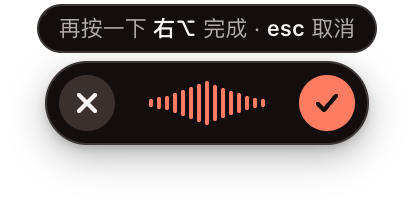
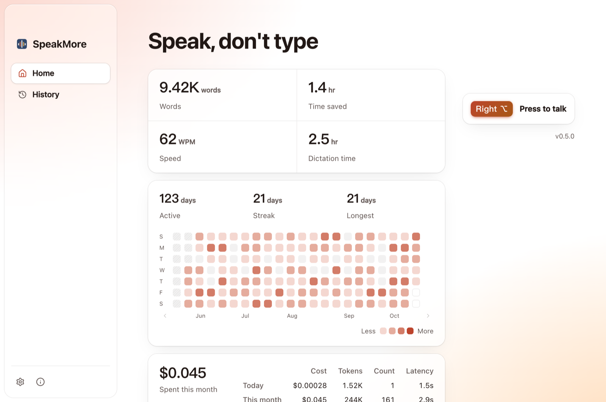
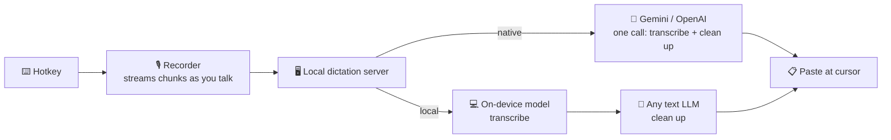

<p align="center">
  
</p>

<h1 align="center">SpeakMore</h1>

<p align="center">
  <b>Tap a key, talk, tap again — clean text lands wherever you're typing.</b><br>
  Open-source voice dictation for macOS and Windows. Bring your own Gemini or OpenAI key.<br>
  <a href="https://speakmore.zephyrxiang.com">speakmore.zephyrxiang.com</a>
</p>

<p align="center">
  
  
  
  
  <a href="LICENSE"></a>
</p>

<p align="center">
  <b>English</b> · <a href="README.zh-CN.md">简体中文</a>
</p>

<p align="center">
  
</p>

<picture>
  <source media="(prefers-color-scheme: dark)" srcset="docs/images/home-dark.png" />
  
</picture>

## 💸 $144 a year → about $1 a month

|  | Typeless Pro | SpeakMore |
| --- | --- | --- |
| **App** | $12/mo billed yearly ($144/yr), or $30/mo | Free, open source |
| **Model** | Included in the subscription | Your own key, pay Google per use: **about $1/month**¹ |
| **Accuracy** | — | On par with Typeless in the author's daily use² |
| **Where your audio goes** | Typeless's servers, along with the current app, window title and on-screen text | Straight to Gemini or OpenAI. No server in between, nothing read from your screen |
| **Account** | Required | None |

<sub>¹ Estimated from the author's real Typeless usage, June–September 2026 (430–870 dictations and 4.5–7 hours of audio per month), at Gemini 3.6 Flash list prices with prompt caching: $0.67–1.05 a month. Free with a free-tier Gemini key. Google has announced that 3.6 Flash prices double on January 1, 2027, which puts it at about $1.30–2.10. Typeless prices from <a href="https://www.typeless.com/pricing">typeless.com/pricing</a>, checked 2026-10-14.<br>
² The prompt was tuned on 60 real recordings, each compared with what Typeless produced. Names and jargon are weaker — see "Known gaps" below.</sub>

## ✨ Features

- 🎙️ **One key, any app** — tap Right Option (Right Alt on Windows), talk, tap again. The text is pasted at your cursor, anywhere you can paste.
- 🧹 **Cleans up as it writes** — drops filler words, false starts and repeats; breaks long speech into paragraphs and lists. Reads like you typed it.
- ⚡ **Fast** — audio streams while you talk; text is usually back about 2 seconds after you stop.
- 🔒 **Your data stays yours** — no account, no middleman server, no analytics. Your key is encrypted with the macOS Keychain (DPAPI on Windows); your history never leaves your computer.
- 🔀 **Two modes, your pick** — *Native*: the audio goes straight to Gemini (default), OpenAI or Qwen-Omni on Alibaba Cloud Bailian. *Local*: a small model on your computer (or a cloud speech model on Bailian, Zhipu or MiniMax) transcribes, then any text LLM polishes it — DeepSeek, Bailian, Kimi, Zhipu, MiniMax, or your own OpenAI-compatible service. With the on-device model the audio never leaves your computer.
- 📊 **See what it costs** — every call is metered; the home window shows words, time saved and streaks.
- 🎨 **Three themes** — Ink, Cinnabar, Indigo. Follows light and dark mode.
- 🌐 **English and 简体中文** — menus, windows and the `speakmore` command follow your system language. Switch any time in Settings; it applies right away.

## 📦 Install

You need macOS 12 or later, or 64-bit Windows 10 (version 1809 or later) or 11, and a [Gemini key](https://aistudio.google.com/apikey) (has a free tier) or an [OpenAI key](https://platform.openai.com/api-keys). Local mode instead needs a key for one of the polish vendors (such as [DeepSeek](https://platform.deepseek.com/api_keys)) or any OpenAI-compatible service, plus about 850 MB for the on-device model.

### macOS, option 1: Download the app (recommended)

| Apple silicon (M1 and later) | Intel |
| --- | --- |
| ⬇️ [SpeakMore-arm64.dmg](https://dl.zephyrxiang.com/speakmore/v0.8.0/SpeakMore-arm64.dmg) | ⬇️ [SpeakMore-x64.dmg](https://dl.zephyrxiang.com/speakmore/v0.8.0/SpeakMore-x64.dmg) |

Open the dmg, drag SpeakMore into Applications, and open it. It's signed with a Developer ID and notarized by Apple, so macOS lets it open normally. The first launch walks you through it: add your key → grant three permissions → test the mic and hotkey → say one sentence for real.

To check a download, add `.sha256` to its link for the checksum.

### macOS, option 2: One line in Terminal

```bash
curl -fsSL https://dl.zephyrxiang.com/speakmore/install.sh | bash
```

It checks your system and network, installs into `~/.speakmore` (no Node, no sudo), asks for your key, and starts. You also get a `speakmore` command for status, history, spend, and switching keys or models.

**Which one?** The app is a standalone app: permissions belong to SpeakMore and it can open at login. The Terminal install runs from your terminal, and permissions belong to that terminal. Choose it if you like commands. Both share the same settings and history; run one at a time.

### Windows: One line in PowerShell

```powershell
irm https://dl.zephyrxiang.com/speakmore/install.ps1 | iex
```

It checks your system, installs into `%USERPROFILE%\.speakmore` (no Node, no admin rights), adds the `speakmore` command to your Path and SpeakMore to the Start menu, asks for your key, and starts. Afterwards open it from the Start menu; it can also open at login. Not code-signed yet.

## 🎙️ Use it

1. Click into any text field and tap **Right Option** (**Right Alt** on Windows).
2. Talk. The bar at the bottom of the screen moves with your voice.
3. Tap again (or click ✓) and the text is pasted. Press `esc` to throw it away.

SpeakMore lives in the menu bar, not the Dock (on Windows, in the notification area of the taskbar). From its icon you can open the main window: stats, history and settings.

## 🛠️ How it works



- **Reverse-engineered, then rebuilt.** The author took apart the Typeless macOS client (app bundle, recovered code, local data, network traffic from their own account) and wrote it up in [18 notes](targets/typeless/docs/00-overview.md) (Chinese). SpeakMore was then written from scratch to follow its protocol and interaction, keeping only dictation. It contains no Typeless code or keys.
- **Two modes, side by side.** Native sends the audio and the prompt together, so recognition and cleanup happen in one call. Local runs [Qwen3-ASR 0.6B](https://huggingface.co/Qwen/Qwen3-ASR-0.6B) on your computer (Metal on Apple silicon, Vulkan on Windows graphics cards, falling back to the CPU), then sends only the text to the model you picked. On the author's Mac, local mode has text back 1.2–1.75 s after you stop; transcription itself takes under 0.7 s ([measurements](bench/results/e2e-local-2026-10-16.md)).
- **Tuned on real recordings.** 60 real recordings, each checked against Typeless's output. The odd slip, like traditional characters or a stray foreign word at the start, is fixed up in code.
- **Prompt caching.** With Gemini, the prompt is cached the moment you start talking, which cuts a dictation from $0.0012 to $0.0003.
- **Electron plus a small native helper** (Swift on macOS, Go on Windows). The helper listens for the hotkey, pastes, and catches `esc`. The app and the CLI share one core.

More detail in the [implementation notes](docs/implementation-notes.md) (Chinese).

## ⚠️ Known gaps

- **Names and jargon get misheard.** Typeless sends on-screen text along as a hint; SpeakMore only sends audio, and has no personal dictionary yet.
- **Tuned for Mandarin**, with English terms mixed in. English-only dictation hasn't been tuned or tested yet (the interface is in English; the prompt isn't).
- **OpenAI cleans up less thoroughly than Gemini.** The prompt was tuned against Gemini.
- **If you stop mid-sentence, the model may finish the sentence for you.**
- **Local mode has only been measured on Apple silicon.** The Intel build ran all four on-device models under Rosetta, but nobody has tried it on a real Intel Mac.
- **Windows is new.** It has been tried on one Windows 11 PC (Intel Core i5, RTX 4060 Ti). The installer and the hotkey helper aren't code-signed yet.
- Dictation only: no translation or "ask anything". The bar shows on the main display only. No Linux.

## 📚 More

<details>
<summary><b>⌨️ Commands</b> (Terminal install only)</summary>

| Command | What it does |
| --- | --- |
| `speakmore` | Start. If it's already running, show status; asks for a key if there isn't one |
| `speakmore stop` / `restart` | Stop / restart, even if it's stuck |
| `speakmore status [--json]` | Running or not, key, permissions, today's and total usage |
| `speakmore update` | Update to the latest version, SpeakMore.app included if you have it. `status` tells you when there's a new one |
| `speakmore history [-n count] [--json]` | What you said. Failed ones show why, and keep the recording |
| `speakmore usage [--json]` | Spend, tokens, count and typical model latency for today, this month and all time, per model |
| `speakmore mode [native\|local]` | Show both modes / switch. Takes effect immediately; checks the key first |
| `speakmore model` | Native mode: available models, which providers have a key, which one is in use |
| `speakmore model <provider>[/<model>]` | Switch provider or model. Asks for a key if needed |
| `speakmore model check [<provider>[/<model>]]` | Send a tiny request to see if it works and how fast |
| `speakmore transcriber [<model>]` | Local mode, step 1: on-device models with size, tags, measured speed and what is downloaded / switch (asks before downloading one you don't have) |
| `speakmore transcriber download\|cancel\|delete <model>` | Download, stop downloading or delete an on-device model. Nothing downloads until you ask; the one in use can't be deleted |
| `speakmore transcriber check [<model>]` | The system voice reads a sentence to the on-device model to see that it transcribes |
| `speakmore polish [<provider>[/<model>]] [--url <url>]` | Local mode, step 2: who polishes the text / switch. `custom/<model> --url <url>` for an OpenAI-compatible service. `polish check` tests it |
| `speakmore key [<provider>]` | Replace a key. Can be piped: `pbpaste \| speakmore key` (Windows: `Get-Clipboard \| speakmore key`). Don't type the key on the command line — it ends up in shell history |
| `speakmore key --forget [<provider>]` | Delete a stored key |
| `speakmore config` / `config set <name> <value>` / `config unset <name>` | Show settings / change one directly, with no checks / reset it |
| `speakmore theme [name]` | List themes / switch, takes effect immediately |
| `speakmore settings` | Open settings |
| `speakmore logs [-n lines] [-f]` | Show logs |
| `speakmore uninstall [--keep-data]` | Uninstall. Says what it will delete and asks first |

</details>

<details>
<summary><b>⚙️ Settings and models</b></summary>

| Name | Default | Values |
| --- | --- | --- |
| `hotkey` | `right_option` (macOS), `right_alt` (Windows) | macOS: `right_option` / `right_command` / `right_control` / `fn`; Windows: `right_alt` / `right_ctrl`. Each a single tap. Typeless uses `fn`, so the default avoids it and both can run side by side |
| `mode` | `native` | `native` / `local`. Switch with `speakmore mode` so the key is checked first |
| `model` | `gemini/gemini-3.6-flash` | Native mode. `provider/model`; a provider alone uses its default model |
| `thinking` | `MINIMAL` | `MINIMAL` / `LOW` / `MEDIUM` / `HIGH`. Higher is slower. Gemini only |
| `transcriber` | `qwen3-asr-0.6b-q8` | Local mode, step 1. See `speakmore transcriber` for the list |
| `polish` | `deepseek/deepseek-flash` | Local mode, step 2. `deepseek` / `deepseek/deepseek-v4-pro` / `custom/<model>` |
| `customUrl` | empty | Address of your OpenAI-compatible service, e.g. `http://127.0.0.1:11434/v1` |
| `modelSource` | `cn` | Where on-device models download from: `cn` (SpeakMore's CDN, fast in China) / `original` (Hugging Face). If one stalls, the other is tried |
| `acceleration` | `auto` | On-device models: `auto` uses the graphics card when there is one and falls back to the CPU if that fails; `cpu` uses only the CPU. Changing it in the app reloads the model on the spot |
| `barHint` | `on` | The hint line above the voice bar ("press … to finish · esc to cancel"). `off` hides it; error messages still show. Also a switch in Settings › General, applied on the spot |
| `theme` | `ink` | `ink` / `cinnabar` / `indigo` |
| `language` | `system` | `system` / `en` / `zh-CN`. `system` follows the system; the `speakmore` command follows your terminal's `LANG`. Languages we don't have fall back to English |

Settings live in `~/.speakmore/settings.json` (`%USERPROFILE%\.speakmore\settings.json` on Windows). `speakmore mode`, `model`, `transcriber` and `polish` check first and switch on the fly; theme, language and download source also apply on the fly. `config set` is the manual back door: it writes any setting without those checks, even one for the other mode, and other changes restart the background app. For a one-off, put `SPEAKMORE_HOTKEY`, `SPEAKMORE_MODE`, `SPEAKMORE_MODEL`, `GEMINI_THINKING_LEVEL`, `SPEAKMORE_TRANSCRIBER`, `SPEAKMORE_POLISH`, `SPEAKMORE_CUSTOM_URL`, `SPEAKMORE_MODEL_SOURCE`, `SPEAKMORE_ACCELERATION`, `SPEAKMORE_THEME` or `SPEAKMORE_LANGUAGE` on the command that starts it; `GEMINI_API_KEY`, `OPENAI_API_KEY`, `DEEPSEEK_API_KEY`, `BAILIAN_API_KEY`, `MOONSHOT_API_KEY` (Kimi), `ZHIPU_API_KEY`, `MINIMAX_API_KEY` and `SPEAKMORE_CUSTOM_API_KEY` override stored keys.

| Provider | Default model | Notes |
| --- | --- | --- |
| `gemini` (default) | `gemini-3.6-flash` | Audio is sent as is. The prompt was tuned against it: cleanest output, text in about 2 seconds |
| `openai` | `gpt-audio-mini` | Takes WAV and MP3 only, so audio is converted to WAV locally first. Text in 2–5 seconds, with more filler left in than Gemini. Recordings over 3 minutes may time out (the recording is kept) |

Each provider keeps its own key, so switching back and forth doesn't ask again. Settings switches provider only; for a specific model use e.g. `speakmore model openai/gpt-audio-1.5`.

Local mode, step 1 — on-device models, measured on Apple silicon with 97 real recordings ([round 1](bench/results/asr-round1-2026-10-16.md); not yet measured on Intel Macs):

| Model | Download | Score (0–5) | Typical time per recording | Notes |
| --- | --- | --- | --- | --- |
| `qwen3-asr-0.6b-q8` (default) | 850 MB | 4.14 | 231 ms (Metal) | Most accurate, best on mixed Chinese–English |
| `sensevoice-small-q8` | 253 MB | 3.94 | 73 ms (Metal) | About 3× faster and a third the size; weaker on English words |
| `qwen3-asr-0.6b-int8` | 987 MB | 4.02 | 1081 ms (CPU) | CPU only |
| `sensevoice-small-int8` | 237 MB | 3.78 | 145 ms (CPU) | CPU only |

Step 2 — `deepseek` (default model `deepseek-flash`) or `custom`: any OpenAI-compatible service.

</details>

<details>
<summary><b>💰 What it costs</b></summary>

Every model call is logged: tokens (including audio and thinking), model, cost and latency. The home window breaks today, this month and all time down by model (the on-device step gets its own free row); `speakmore usage` has more detail.

- Costs are **estimates** in US dollars, from each provider's standard list price. Gemini's free tier actually costs nothing, but the API doesn't say which tier a key is on, so everything is priced as paid.
- For a few seconds of speech, most of the cost is the prompt sent every time (about 1,350 tokens). Gemini's prompt cache bills that part at a tenth of the price. The cache itself costs a little (about $0.001 to create, about $0.0007 an hour to keep) and expires after 30 quiet minutes. OpenAI's `gpt-audio` models have no cache.
- If a request goes out but no reply comes back (timeout, disconnect), there's no usage to record, though the provider may still have charged for it.

</details>

<details>
<summary><b>🔐 The three macOS permissions</b></summary>

| Permission | Used for | Without it |
| --- | --- | --- |
| Microphone | Recording | Pressing the hotkey says there's no mic access |
| Input Monitoring | Hearing the hotkey. Only that one key; nothing else is recorded | The hotkey does nothing |
| Accessibility | Pasting with a simulated ⌘V; catching `esc` and clicks on the bar while you talk | Text goes to the clipboard and you press ⌘V; `esc` can't cancel |

For the app, permissions belong to SpeakMore. When started with the `speakmore` command, they belong to **the terminal you ran it from** (Terminal, iTerm, Ghostty…) — look for that in System Settings. Run `speakmore status` afterwards to recheck.

On Windows only the microphone needs permission (Settings › Privacy & security › Microphone, "Let desktop apps access your microphone"). Hearing the hotkey and pasting need nothing. Windows doesn't let a normal app paste into a window running as administrator; there the text stays on the clipboard and the bar says so.

</details>

<details>
<summary><b>🗂️ Where things live</b></summary>

**The only thing sent out is your audio** (native mode) **or the transcribed text** (local mode), straight to the provider you picked, with your own key. Everything kept locally is in `~/.speakmore/` (`%USERPROFILE%\.speakmore\` on Windows), readable only by you:

| What | Notes |
| --- | --- |
| `settings.json` | Settings |
| `gemini-key.bin`, `openai-key.bin`, `deepseek-key.bin`… | Encrypted keys, one per provider, shared by the app and the terminal. The decryption key is "SpeakMore Safe Storage" in your Keychain (on Windows, DPAPI ties it to your Windows account), so a copied file is useless. Versions up to 0.7.0 kept a separate `.app` copy for the app; it's left in place for rolling back |
| `data/history.db`, `data/Recordings/` | What you said, the recordings and the cost log. Failed dictations keep their recording |
| `logs/main.log` | Logs. Lengths, timings and usage only — never what you said, never the key |
| `models/` | On-device models for local mode, downloaded only when you ask and checked against their SHA-256 |
| `bin/`, `app/`, `runtime/` | The Terminal install itself; replaced on upgrade |

Outside that folder: the `~/.local/bin/speakmore` link, the Keychain entry, the permissions you granted, and SpeakMore in Applications if you installed the app. On Windows: one entry in your user Path, the Start menu shortcut, and a startup entry in the registry if you turned on open at login. To install elsewhere, set `SPEAKMORE_HOME` when installing.

</details>

<details>
<summary><b>🩺 Troubleshooting</b></summary>

| You see | Do this |
| --- | --- |
| The key line says "not verified yet" | It couldn't reach Gemini at startup and is using the stored key. Once online, run `speakmore status` |
| "Missing: Gemini check" (or OpenAI) | Usually a wrong model name or thinking level, not the key. `speakmore model check` shows the reply; `speakmore config unset model` resets |
| "Missing: key listener" | The hotkey helper stopped. `speakmore restart`; if that fails, `speakmore logs` |
| A command says "didn't reply within 5 seconds" | The background app is stuck. `speakmore stop` force-quits it; then run `speakmore` |
| No menu bar icon | On notched MacBooks, extra icons hide behind the notch. ⌘-drag some icons out of the menu bar, or use `speakmore settings` and `speakmore history` |

</details>

<details>
<summary><b>🔄 Upgrade and uninstall</b></summary>

- **Upgrade**: Terminal and Windows — `speakmore update`. It also updates SpeakMore.app if you have it, and reopens whichever one was running. App only — download the new dmg and drag it in again. Settings, keys, history and recordings are kept.
- **Uninstall**: app — quit from the menu bar and drag SpeakMore from Applications to the Trash. Terminal — `speakmore uninstall` stops it and removes `~/.speakmore`, the command link and the Keychain entry; add `--keep-data` to keep your data. Windows — `speakmore uninstall` removes `%USERPROFILE%\.speakmore`, the Path entry, the Start menu shortcut and the startup entry.
- **Going back to 0.4.2 or earlier**: newer versions add a cost table that older ones refuse to open. First run `sqlite3 ~/.speakmore/data/history.db "DROP TABLE model_calls; PRAGMA user_version = 1;"` — you lose the cost log, not your history.

</details>

## 🧑‍💻 Development

```bash
git clone https://github.com/zephyr4123/speakmore.git && cd speakmore
npm install
npm start          # same as the speakmore command
npm run check      # lint and all tests
```

Project layout, packaging, releases, and what each version was actually tested on: see the [development notes](docs/development.md) (Chinese).

## License

[MIT](LICENSE). Files under `.claude/skills/` come from [REA](https://github.com/morluto/rea) under its own MIT license.

The name is a nod to Typeless. SpeakMore is an independent implementation based on reverse-engineering notes, not affiliated with Typeless.
