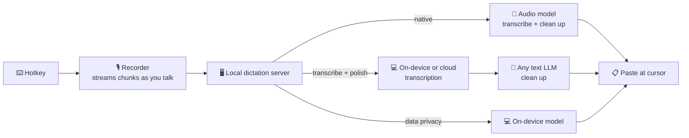

<p align="center">
  
</p>

<h1 align="center">SpeakMore</h1>

<p align="center">
  <b>Speak more. Type less.</b><br>
  Free, open-source voice dictation for Mac and Windows.<br>
  Plug in any model you like, or keep everything on your own computer.<br>
  <a href="https://speakmore.zephyrxiang.com">speakmore.zephyrxiang.com</a>
</p>

<p align="center">
  
  
  
  <a href="LICENSE"></a>
</p>

<p align="center">
  <b>English</b> · <a href="README.zh-CN.md">简体中文</a>
</p>

<p align="center">
  
</p>

<picture>
  <source media="(prefers-color-scheme: dark)" srcset="https://media.speakmore.zephyrxiang.com/readme/home-dark.en.d337323a.webp" />
  
</picture>

Tap a key, talk, tap again: the text lands wherever your cursor is. With Native or Transcribe + Polish it comes out clean and punctuated: filler words, false starts and repeats are gone, and long speech is split into paragraphs and lists.

## Five freedoms

<table>
  <tr>
    <td align="center">🧩</td>
    <td><a href="#-model-freedom"><b>Model freedom</b></a></td>
    <td>29 models from Gemini, OpenAI, Qwen, DeepSeek, Kimi, GLM and MiniMax, or any OpenAI-compatible service. Use the key you already have.</td>
  </tr>
  <tr>
    <td align="center">🔀</td>
    <td><a href="#-mode-freedom"><b>Mode freedom</b></a></td>
    <td>Three recognition modes, side by side: Native, Transcribe + Polish, and Data Privacy. Recommended setups switch in one click.</td>
  </tr>
  <tr>
    <td align="center">💻</td>
    <td><a href="#-hardware-freedom"><b>Hardware freedom</b></a></td>
    <td>Mac with Apple silicon or Intel, and Windows. On-device models run on Metal, on Vulkan (NVIDIA, AMD and Intel graphics), or on the CPU.</td>
  </tr>
  <tr>
    <td align="center">🔒</td>
    <td><a href="#-privacy-freedom"><b>Privacy freedom</b></a></td>
    <td>Data Privacy mode transcribes on your computer and uploads nothing. No key, no account. The model downloads in one click.</td>
  </tr>
  <tr>
    <td align="center">💸</td>
    <td><a href="#-spending-freedom"><b>Spending freedom</b></a></td>
    <td>The app is free. Pay model vendors directly, by use. The recommended setups cost $0 to about $5 a month at 100 dictations a day.</td>
  </tr>
</table>

## 🚀 Get started

<p align="center">
  <a href="https://dl.zephyrxiang.com/speakmore/v0.9.0/SpeakMore-arm64.dmg"></a>
  <a href="https://dl.zephyrxiang.com/speakmore/v0.9.0/SpeakMore-x64.dmg"></a>
  <a href="https://dl.zephyrxiang.com/speakmore/v0.9.0/SpeakMore-Setup-x64.exe"></a>
</p>

| | Requires | Install |
| --- | --- | --- |
| **Mac** | macOS 12 or later | Open the dmg and drag SpeakMore into Applications. Signed with a Developer ID and notarized by Apple. |
| **Windows** | Windows 10 (1809 or later) or 11, 64-bit | Double-click the installer. If Windows shows "Windows protected your PC", click **More info → Run anyway**. It installs for your account only, with no admin rights and no network needed. |

Prefer a terminal? One line installs the same thing, plus the `speakmore` command:

```bash
# macOS
curl -fsSL https://dl.zephyrxiang.com/speakmore/install.sh | bash
```

```powershell
# Windows (PowerShell)
irm https://dl.zephyrxiang.com/speakmore/install.ps1 | iex
```

To check a download, add `.sha256` to its link for the checksum.

<details>
<summary><b>App or terminal install?</b></summary>

The downloaded app is a standalone app: macOS permissions belong to SpeakMore, and it can open at login. The terminal install runs from your terminal on macOS, and permissions belong to that terminal. On Windows both install the same thing into `%USERPROFILE%\.speakmore` and add SpeakMore to the Start menu. Either way you get the same settings, history and `speakmore` command; run one at a time.

</details>

## 🎙️ Use it

1. Click into any text field and tap **Right Option** (**Right Alt** on Windows).
2. Talk. The bar at the bottom of the screen moves with your voice.
3. Tap again. The text is pasted at your cursor. `esc` throws it away.

SpeakMore lives in the menu bar (the notification area on Windows). Its main window has your stats, history, models and settings.

### First run

The first launch walks you through it. Every step goes back and forward, and every step can be skipped and finished later in the main window. Data Privacy needs no key at all.

<table>
  <tr>
    <td width="50%"></td>
    <td width="50%"></td>
  </tr>
  <tr>
    <td align="center"><sub><b>1</b> · Pick a recognition mode</sub></td>
    <td align="center"><sub><b>2</b> · Add a key, or skip it for now</sub></td>
  </tr>
  <tr>
    <td></td>
    <td></td>
  </tr>
  <tr>
    <td align="center"><sub><b>3</b> · Or download an on-device model in the background</sub></td>
    <td align="center"><sub><b>4</b> · Grant permissions</sub></td>
  </tr>
  <tr>
    <td></td>
    <td></td>
  </tr>
  <tr>
    <td align="center"><sub><b>5</b> · Test the microphone</sub></td>
    <td align="center"><sub><b>6</b> · Test the hotkey</sub></td>
  </tr>
  <tr>
    <td></td>
    <td></td>
  </tr>
  <tr>
    <td align="center"><sub><b>7</b> · Say one sentence for real</sub></td>
    <td align="center"><sub><b>8</b> · Done</sub></td>
  </tr>
</table>

## 🧩 Model freedom

<picture>
  <source media="(prefers-color-scheme: dark)" srcset="https://media.speakmore.zephyrxiang.com/readme/vendors-dark.en.51093b18.webp" />
  
</picture>

<sub>Names and logos belong to their owners. They are shown only to say which services SpeakMore works with.</sub>

The **Models** page lists every model by role: **7 native** (audio in, text out), **10 transcription** (4 on-device, 6 in the cloud) and **12 polishing** models, with list prices and measured scores. When several platforms sell the same model, it is one row and you pick the channel.

Keys are per platform, so the key you already have is enough. One Alibaba Cloud Bailian key covers 14 models; official DeepSeek, Kimi, GLM, MiniMax, Gemini and OpenAI keys work directly; any OpenAI-compatible service plugs in with an address and a key.

<table>
  <tr>
    <td width="50%"></td>
    <td width="50%"></td>
  </tr>
  <tr>
    <td align="center"><sub>Every model, every channel</sub></td>
    <td align="center"><sub>One key per platform</sub></td>
  </tr>
</table>

## 🔀 Mode freedom

Three ways to turn speech into text. Each mode keeps its own models, so switching back and forth costs nothing.

| Mode | How it works | What leaves your computer | Key |
| --- | --- | --- | --- |
| ✨ **Native** | Audio → Gemini, OpenAI or Qwen-Omni → finished text, in one request | The recording, to the vendor you chose | One |
| 🪄 **Transcribe + Polish** | Audio → on-device or cloud transcription → any LLM polishes the text | With on-device transcription, only the text | One |
| 🛡️ **Data Privacy** | Audio → on-device model → text | Nothing | None |

<table>
  <tr>
    <td width="50%"></td>
    <td width="50%"></td>
  </tr>
  <tr>
    <td align="center"><sub>Switch modes from the home window</sub></td>
    <td align="center"><sub>Recommended setups, one click each</sub></td>
  </tr>
</table>

**Recommended setups** bundle a whole route, check it, and switch to it in one click. Missing keys and downloads are filled in on the spot.

| Setup | Route | Per month¹ |
| --- | --- | --- |
| On-device + DeepSeek | Qwen3-ASR 0.6B on your computer → DeepSeek V4.1 Flash | **≈ $0.39** |
| Gemini Native | Gemini 3.6 Flash | ≈ $5.29 |
| Bailian Cloud | Qwen3 ASR Flash → DeepSeek V4.1 Flash, one key | ≈ $3.02 |
| Fully On-device | Qwen3-ASR 0.6B, nothing uploaded | **$0** |

<sub>¹ 100 dictations a day for 30 days, each the size of a typical dictation (26 seconds, the average of 97 real ones), at each vendor's list price. The app works out the same number live from its price list. Intel Macs get the same setups with SenseVoice Small on the CPU.</sub>

## 💻 Hardware freedom

The same on-device models run on every supported machine. SpeakMore uses the graphics card when there is one and falls back to the CPU on its own.

| Machine | Runs on | Qwen3-ASR 0.6B, typical dictation² |
| --- | --- | --- |
| Mac with Apple silicon | Metal | **231 ms**, 68× real time |
| Windows with a graphics card (NVIDIA, AMD or Intel) | Vulkan | **240 ms**, 73× real time (RTX 4060 Ti) |
| Any Mac or PC | CPU | SenseVoice Small: 145 ms (Apple silicon) · 463 ms (Core i5-13400F) |

<sub>² Median time to transcribe one of 97 real dictations, from the benchmarks below.</sub>


## 🔒 Privacy freedom

- **Data Privacy mode uploads nothing.** An on-device model turns your voice into text on your computer. No key, no account.
- **One-click download, fast in China.** Models come from SpeakMore's own mirror in China, fall back to Hugging Face on their own, and are checked against SHA-256. The 850 MB default model takes about a minute and a half.
- **Nothing in between, in every mode.** No SpeakMore server, no analytics. Audio or text goes straight to the vendor you picked, with your own key.
- **Keys are encrypted** with the macOS Keychain (DPAPI on Windows). History and recordings stay on your computer.

<picture>
  <source media="(prefers-color-scheme: dark)" srcset="https://media.speakmore.zephyrxiang.com/readme/download-speed-dark.en.8b4db543.webp" />
  
</picture>

## 💸 Spending freedom

SpeakMore is free. You pay model vendors directly, only for what you use, and the home window shows every cent. Here is a heavy user, 100 dictations a day, next to every Typeless plan:

| | Per month | Per year | Words | Where your voice goes | Account |
| --- | --- | --- | --- | --- | --- |
| Typeless Free | $0 | $0 | Weekly limit | Typeless's servers³ | Required |
| Typeless Pro, billed yearly | $12 | $144 | Unlimited | Typeless's servers³ | Required |
| Typeless Pro, billed monthly | $30 | $360 | Unlimited | Typeless's servers³ | Required |
| Typeless Enterprise | Contact sales | | Unlimited | Typeless's servers³ | Required, with SSO |
| **SpeakMore · Fully On-device** | **$0** | **$0** | Unlimited | **Stays on your computer** | **None** |
| **SpeakMore · On-device + DeepSeek** | **≈ $0.39** | **≈ $4.70** | Unlimited | Text only, to DeepSeek | **None** |
| **SpeakMore · Bailian Cloud** | **≈ $3.02** | **≈ $36** | Unlimited | Alibaba Cloud Bailian | **None** |
| **SpeakMore · Gemini Native** | **≈ $5.29** | **≈ $63** | Unlimited | Google | **None** |

<sub>Typeless prices from <a href="https://www.typeless.com/pricing">typeless.com/pricing</a>, checked 2026-10-17. SpeakMore estimates as in the setups table above, at list prices on 2026-10-17. A free Gemini key costs nothing.<br>
³ Along with the current app, the window title and text on the screen (<a href="targets/typeless/docs/06-context-capture-and-privacy.md">notes</a>, Chinese).</sub>

## 📊 Benchmarks

The default prompt was tuned on 60 real recordings, each compared with what Typeless produced for the same audio. The on-device models were measured on 97 real dictations (42.5 minutes: Chinese, Chinese–English mixed and English), scored 0–5 against the native Gemini output by a fixed rubric.

<details>
<summary><b>On-device transcription: Apple silicon and Windows</b></summary>

| Model | Mac (Apple silicon) | Windows (i5-13400F, RTX 4060 Ti) | Score | Size |
| --- | --- | --- | --- | --- |
| `qwen3-asr-0.6b-q8` (default) | Metal · 231 ms · 68× | Vulkan · 240 ms · 73× | 4.14–4.16 | 850 MB |
| `sensevoice-small-q8` | Metal · 73 ms · 226× | Vulkan · 107 ms · 186× | 3.94 | 253 MB |
| `qwen3-asr-0.6b-int8` | CPU · 1081 ms · 15× | CPU · 3388 ms · 5× | 4.02–4.06 | 987 MB |
| `sensevoice-small-int8` | CPU · 145 ms · 107× | CPU · 463 ms · 37× | 3.75–3.78 | 237 MB |

Times are the median per dictation; × is audio length divided by time. By language, Qwen3-ASR scores 4.32 on Chinese and 4.02 on mixed Chinese–English; SenseVoice scores 4.38 on Chinese. Full tables: [Apple silicon](bench/results/asr-round1-2026-10-16.md), [Windows](bench/results/asr-windows-2026-10-17.md) (Chinese).

</details>

<details>
<summary><b>End to end: Transcribe + Polish on Apple silicon</b></summary>

From releasing the key to text on screen: **1.2–1.75 seconds**, with transcription itself under 0.7 seconds and the rest in the polishing request. One DeepSeek polish costs about $0.00004, as most of the prompt is served from cache. [Measurements](bench/results/e2e-local-2026-10-16.md) (Chinese).

</details>

The benchmark harness is in [`bench/`](bench/README.md): add a model and only its column runs.

## ✅ Built to be trusted

- **Open source**, MIT. Read every line that touches your voice.
- **No account.** Nothing to sign up for, nothing to log in to.
- **One folder.** The app's data, settings, keys, models and logs live in `~/.speakmore` (`%USERPROFILE%\.speakmore` on Windows). `speakmore uninstall` removes all of it.
- **Signed and notarized** on Mac; every download has a SHA-256 checksum.
- **Reverse-engineered, then rebuilt.** The Typeless client was taken apart in [18 notes](targets/typeless/docs/00-overview.md) (Chinese); SpeakMore was written from scratch to match its interaction, and contains no Typeless code or keys.

## 🧑‍💻 For developers

- **The command line does what the app does.** Switch modes and models, store and check keys, download models, read history and spend. `status`, `history` and `usage` print JSON with `--json`.
- **Plug-in architecture.** Every vendor is a strategy behind one interface: audio is normalized to 16 kHz mono, and every transcriber returns `{ text }`.
- **A Mac drives the Windows build.** [`scripts/dev/win-*.sh`](scripts/dev) sync the working tree to a Windows machine over SSH, run the tests there, restart the app from source with a debugging port, and screenshot its desktop.
- **Tested.** 939 unit tests and 19 install tests, Biome lint, and gates on design tokens and interface copy. `npm run check` runs them all.

```bash
git clone https://github.com/zephyr4123/speakmore.git && cd speakmore
npm install
npm start          # same as the speakmore command
npm run check      # lint and all tests
```



Project layout, packaging, releases, and what each version was tested on: [development notes](docs/development.md) and [implementation notes](docs/implementation-notes.md) (Chinese).

## 📚 Reference

<details>
<summary><b>⌨️ Commands</b></summary>

| Command | What it does |
| --- | --- |
| `speakmore` | Start. If it's already running, show status |
| `speakmore stop` / `restart` | Stop / restart |
| `speakmore status [--json]` | Running or not, key, permissions, today's and total usage |
| `speakmore update` | Update to the latest version, SpeakMore.app included. Settings, keys, history and recordings are kept |
| `speakmore history [-n count] [--json]` | What you said, newest first |
| `speakmore usage [--json]` | Spend, tokens and reply times today, this month and all time, per model |
| `speakmore mode [native\|local\|private]` | Show the three modes / switch, live. `local` is Transcribe + Polish, `private` is Data Privacy |
| `speakmore model [<provider>[/<model>]]` | Native mode: providers (`gemini` / `openai` / `bailian`) and which has a key / switch |
| `speakmore transcriber [<model>]` | Transcription models with size, measured speed and what is downloaded / switch |
| `speakmore transcriber download\|cancel\|delete <model>` | Manage on-device models |
| `speakmore polish [<provider>[/<model>]] [--url <url>]` | Polishing model: `deepseek` / `bailian` / `moonshot` / `zhipu` / `minimax` / `custom` |
| `speakmore model check`, `transcriber check`, `polish check` | Send a tiny request (or have the system voice read a sentence) to see that it works and how fast |
| `speakmore key [<provider>]` | Replace a key. Can be piped: `pbpaste \| speakmore key` (Windows: `Get-Clipboard \| speakmore key`) |
| `speakmore key --forget [<provider>]` | Delete a stored key |
| `speakmore config` / `config set <name> <value>` / `config unset <name>` | Show settings / change one directly / reset it |
| `speakmore theme [name]` | List themes / switch, live |
| `speakmore settings` | Open settings |
| `speakmore logs [-n lines] [-f]` | Show logs |
| `speakmore uninstall [--keep-data]` | Uninstall. Says what it will delete and asks first |

</details>

<details>
<summary><b>⚙️ Settings</b></summary>

| Name | Default | Values |
| --- | --- | --- |
| `hotkey` | `right_option` (macOS), `right_alt` (Windows) | macOS: `right_option` / `right_command` / `right_control` / `fn`; Windows: `right_alt` / `right_ctrl` |
| `mode` | `native` | `native` / `local` / `private` |
| `model` | `gemini/gemini-3.6-flash` | Native mode, `provider/model` |
| `thinking` | `MINIMAL` | Gemini's thinking level: `MINIMAL` / `LOW` / `MEDIUM` / `HIGH` |
| `transcriber` | `qwen3-asr-0.6b-q8` | Transcribe + Polish, step 1: an on-device model or a cloud one such as `bailian/qwen3-asr-flash` |
| `privateTranscriber` | `qwen3-asr-0.6b-q8` | Data Privacy: which on-device model |
| `polish` | `deepseek/deepseek-flash` | Transcribe + Polish, step 2, `provider/model`; `custom/<model>` for your own service |
| `customUrl` | empty | Your OpenAI-compatible service, e.g. `http://127.0.0.1:11434/v1` |
| `modelSource` | `cn` | Where on-device models download from: `cn` (SpeakMore's mirror) / `original` (Hugging Face) |
| `acceleration` | `auto` | `auto` uses the graphics card when there is one; `cpu` uses only the CPU |
| `barHint` | `on` | The hint line above the voice bar: `on` / `off` |
| `theme` | `ink` | `ink` / `cinnabar` / `indigo` |
| `language` | `system` | `system` / `en` / `zh-CN` |

Settings live in `~/.speakmore/settings.json`. The app, `speakmore mode`, `model`, `transcriber` and `polish` check before switching, and apply on the fly. `config set` writes a setting directly, without checks. For a one-off, set `SPEAKMORE_HOTKEY`, `SPEAKMORE_MODE`, `SPEAKMORE_MODEL`, `SPEAKMORE_TRANSCRIBER`, `SPEAKMORE_POLISH`, `SPEAKMORE_THEME`, `SPEAKMORE_LANGUAGE` and so on when starting it; `GEMINI_API_KEY`, `OPENAI_API_KEY`, `DEEPSEEK_API_KEY`, `BAILIAN_API_KEY`, `MOONSHOT_API_KEY` (Kimi), `ZHIPU_API_KEY`, `MINIMAX_API_KEY` and `SPEAKMORE_CUSTOM_API_KEY` override stored keys.

</details>

<details>
<summary><b>💰 How spend is counted</b></summary>

Every model call is logged with its tokens (audio and thinking included), model, cost and latency. The home window breaks today, this month and all time down by model; on-device transcription gets its own free row. `speakmore usage` has more detail.

- Costs are estimates in US dollars at each vendor's list price; platforms that price in yuan are converted at 6.71.
- Gemini's prompt cache bills the repeated prompt at a tenth of the price; SpeakMore warms the cache the moment you start talking.

</details>

<details>
<summary><b>🔐 Permissions</b></summary>

| macOS permission | Used for |
| --- | --- |
| Microphone | Recording |
| Input Monitoring | Hearing the hotkey. Only that one key; nothing else is recorded |
| Accessibility | Pasting with a simulated ⌘V, and catching `esc` while you talk |

The app asks for these during onboarding. With the terminal install, they belong to the terminal you ran it from. On Windows only the microphone needs permission (Settings › Privacy & security › Microphone).

</details>

<details>
<summary><b>🗂️ Where things live</b></summary>

Everything is in `~/.speakmore/` (`%USERPROFILE%\.speakmore\` on Windows), readable only by you:

| What | Notes |
| --- | --- |
| `settings.json` | Settings |
| `<vendor>-key.bin` | Encrypted keys, one per vendor. The decryption key is in your Keychain (DPAPI on Windows), so a copied file is useless |
| `data/history.db`, `data/Recordings/` | What you said, the recordings and the spend log |
| `logs/main.log` | Lengths, timings and usage. Never what you said, never a key |
| `models/` | On-device models, downloaded when you ask and checked against SHA-256 |
| `bin/`, `app/`, `runtime/` | The terminal install itself |

Outside that folder: the Keychain entry, the permissions you granted, SpeakMore in Applications, and on Windows the Start menu shortcut, one Path entry and the open-at-login entry.

</details>

<details>
<summary><b>🩺 Troubleshooting</b></summary>

| You see | Do this |
| --- | --- |
| A key shows "not verified yet" | It couldn't reach the vendor at startup and is using the stored key. Once online, run `speakmore status` |
| A check fails but the key is right | Usually the model name or thinking level. `speakmore model check` shows the reply; `speakmore config unset model` resets |
| The hotkey does nothing | `speakmore status` names what is missing; `speakmore restart` restarts the key listener |
| A command says "didn't reply within 5 seconds" | `speakmore stop`, then `speakmore` |
| No menu bar icon | On notched MacBooks extra icons hide behind the notch. ⌘-drag some icons out, or use `speakmore settings` |

</details>

<details>
<summary><b>🔄 Update and uninstall</b></summary>

- **Update**: `speakmore update` updates the terminal install and SpeakMore.app, and reopens whichever was running. With the app alone, download the new dmg and drag it in again. Settings, keys, history and recordings are kept.
- **Uninstall**: `speakmore uninstall` stops SpeakMore and removes the whole folder, the command and the Keychain entry (on Windows also the Path entry, the Start menu shortcut and the startup entry). `--keep-data` keeps your settings, keys, history and recordings. For the app alone, quit it from the menu bar and drag it to the Trash.

</details>

## License

[MIT](LICENSE). Files under `.claude/skills/` come from [REA](https://github.com/morluto/rea) under its own MIT license.

The name is a nod to Typeless. SpeakMore is an independent implementation based on reverse-engineering notes, not affiliated with Typeless.
