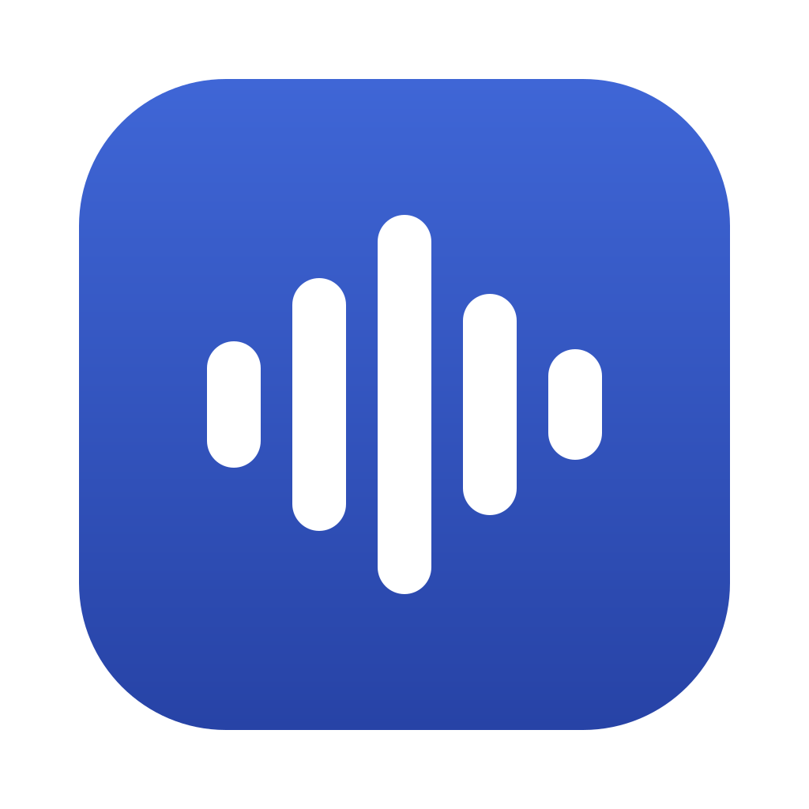
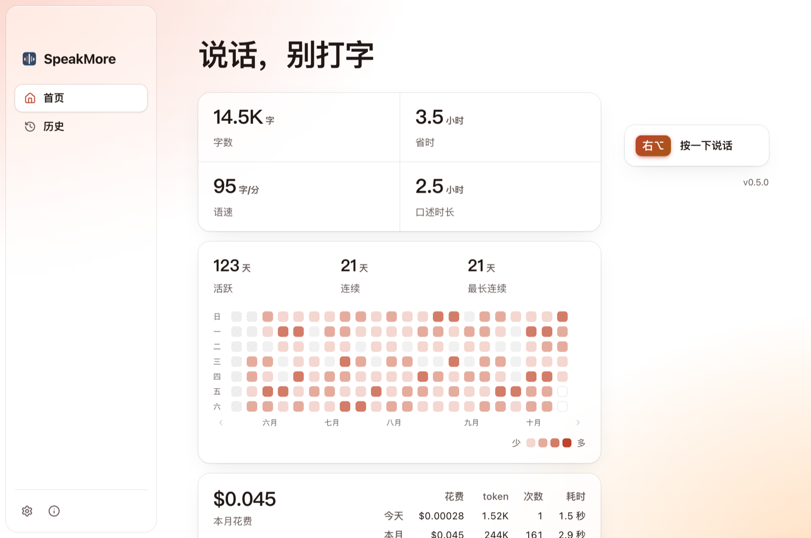
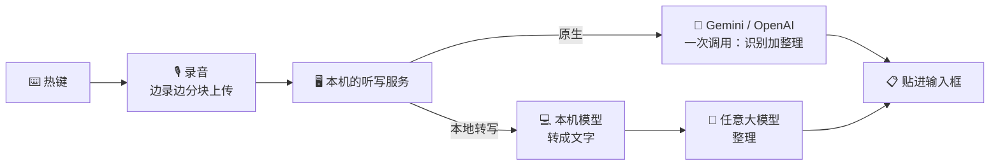

<p align="center">
  
</p>

<h1 align="center">SpeakMore</h1>

<p align="center">
  <b>按一下，说话，再按一下：整理好的文字就贴进你正在打字的地方。</b><br>
  macOS 上的开源语音输入，用你自己的 Gemini 或 OpenAI key。<br>
  <a href="https://speakmore.zephyrxiang.com/?lang=zh-CN">speakmore.zephyrxiang.com</a>
</p>

<p align="center">
  
  
  
  <a href="LICENSE"></a>
</p>

<p align="center">
  <a href="README.md">English</a> · <b>简体中文</b>
</p>

<p align="center">
  
</p>

<picture>
  <source media="(prefers-color-scheme: dark)" srcset="docs/images/home-dark.zh-CN.png" />
  
</picture>

## 💸 Typeless 一年 $144，这里一个月几块钱

|  | Typeless Pro | SpeakMore |
| --- | --- | --- |
| **软件** | $12/月，按年付（一年 $144）；按月付 $30/月 | 免费，开源 |
| **模型** | 含在订阅里 | 你自己的 key，按量付给 Google：**每月约 $1（¥5–7）**¹ |
| **准确度** | — | 作者天天在用，和 Typeless 几乎没差别² |
| **录音发给谁** | Typeless 自己的服务器，连同当前应用、窗口标题、屏幕上的文字 | 直接发给 Gemini 或 OpenAI，中间没有别的服务器，不读屏幕 |
| **账号** | 要 | 不要 |

<sub>¹ 拿作者 2026 年 6–9 月在 Typeless 上的真实用量（每月 430–870 次、4.5–7 小时录音），按 Gemini 3.6 Flash 官方标准价、算上提示词缓存估算：每月 $0.67–1.05。Gemini 免费额度内用是 0 元。Google 已公布 3.6 Flash 从 2027 年 1 月 1 日起涨一倍，到时约 $1.3–2.1。Typeless 的价格来自 <a href="https://www.typeless.com/pricing">typeless.com/pricing</a>（2026-10-14 查）。<br>
² 提示词拿 60 条真实录音、逐条对着 Typeless 的成品调过。专有名词和人名弱一些，见下面的“现在的不足”。</sub>

## ✨ 特色

- 🎙️ **一个键，哪都能用**：按一下右 Option 开始说，再按一下，文字贴进光标所在的地方。能粘贴的地方都行。
- 🧹 **边说边整理**：口头禅、改口、重复删掉，长的话分段、分点，像你自己打出来的。
- ⚡ **快**：边说边上传，说完一般 2 秒出字。
- 🔒 **数据在你手里**：没有账号，没有中间服务器，没有统计上报。key 加密存在钥匙串里，说过的话只存在本机。
- 🔀 **两种模式自己选**：*原生*是录音直接交给 Gemini（默认）或 OpenAI；*本地转写*是本机的小模型先转成文字，再交给任意大模型润色，可以是 DeepSeek，也可以是你自己的兼容 OpenAI 接口的服务。本地转写时录音不出本机。
- 📊 **花多少钱一清二楚**：每次调用都记账；首页看字数、省下的时间、连续天数。
- 🎨 **三套主题**：墨、朱砂、靛青，跟随系统深浅色。
- 🌐 **简体中文和英文**：菜单栏、窗口、`speakmore` 命令都跟着系统的语言走，设置里随时能换，当场生效。

## 📦 安装

需要 macOS 12 以上，和一把 [Gemini key](https://aistudio.google.com/apikey)（有免费额度）或 [OpenAI key](https://platform.openai.com/api-keys)。用本地转写的话，换成一把 [DeepSeek key](https://platform.deepseek.com/api_keys) 或任意兼容 OpenAI 接口的服务，本机模型约 850 MB。

### 方式一：下载安装包（推荐）

| Apple 芯片（M1 及以后） | Intel 芯片 |
| --- | --- |
| ⬇️ [SpeakMore-arm64.dmg](https://dl.zephyrxiang.com/speakmore/v0.7.0/SpeakMore-arm64.dmg) | ⬇️ [SpeakMore-x64.dmg](https://dl.zephyrxiang.com/speakmore/v0.7.0/SpeakMore-x64.dmg) |

打开 dmg，把 SpeakMore 拖进“应用程序”，再打开它。安装包有开发者签名、过了苹果公证，系统不会拦。第一次打开会带你走一遍：填 key → 开三项权限 → 测麦克风和热键 → 真说一句。

想核对下回来的包：在链接后面加上 `.sha256` 就是它的校验值。

### 方式二：命令行一行装好

```bash
curl -fsSL https://dl.zephyrxiang.com/speakmore/install.sh | bash
```

先检查系统、芯片、网络，然后装进 `~/.speakmore`（不需要 Node，也不需要 sudo），在终端里问你要 key，最后启动。多了一个 `speakmore` 命令：看状态、历史、花费，换 key、换模型。

**选哪个？** 安装包是一个独立的应用：权限记在 SpeakMore 名下，能开机启动。命令行装的从终端启动，权限记在终端名下，适合想用命令的人。两种用的是同一份设置和历史，同一时间只开一个。

## 🎙️ 怎么用

1. 点进任意输入框，按一下 **右 Option**。
2. 说话。屏幕下方的悬浮条跟着你的声音跳。
3. 再按一下（或者点 ✓），文字就贴进去了。不想要了按 `esc`。

它只待在菜单栏，不占程序坞。菜单栏图标能打开主窗口：首页统计、历史记录、设置。

## 🛠️ 怎么做的



- **先逆向，再重写**：拆了 Typeless 的 macOS 客户端，读了安装包、还原出来的代码、本机数据和自己账号的流量，写成 [18 篇文档](targets/typeless/docs/00-overview.md)。然后照着它的协议和交互从头写了一个，只做语音转写，不含 Typeless 的任何代码和密钥。
- **两种模式平级**：原生是录音和提示词一起交给模型，识别和整理一次调用完成。本地转写在本机跑 [Qwen3-ASR 0.6B](https://huggingface.co/Qwen/Qwen3-ASR-0.6B)（Apple 芯片上用 Metal），只把文字发给你选的模型。在作者的 Mac 上，本地转写说完 1.2–1.75 秒出字，其中转写本身不到 0.7 秒（[实测记录](bench/results/e2e-local-2026-10-16.md)）。
- **提示词用真实录音调**：60 条真实录音逐条对照 Typeless 的成品。模型偶尔写出的繁体字、开头多出的外文词，在代码里兜底。
- **提示词缓存**：用 Gemini 时，一开口就把提示词缓存起来，一句的花费从 $0.0012 降到 $0.0003。
- **Electron 加一个 Swift 小程序**：小程序负责听热键、贴字、截住 `esc`。桌面应用和命令行共用一套内核。

细节在[实现笔记](docs/implementation-notes.md)里。

## ⚠️ 现在的不足

- **专有名词和人名会听错**：Typeless 会把屏幕上的文字一起传上去当参考，这里只有录音，也还没有个人词典。
- **提示词是按中文调的**（夹着英文词也行）。纯英文听写没有调过，也没测过（界面有英文，提示词没有）。
- **换成 OpenAI 时整理得比 Gemini 粗**：提示词是对着 Gemini 调的。
- **话说到一半就按停，模型可能自己把后半句补上。**
- **本地转写只在 Apple 芯片上测过**：Intel 版在 Rosetta 下四个本机模型都跑通了，但没在真的 Intel 机器上试过。
- 只有听写，没有翻译和“问任何事”。悬浮条只在主屏幕上。Windows 和 Linux 还没有。

## 📚 更多

<details>
<summary><b>⌨️ 命令</b>（命令行安装的才有）</summary>

| 命令 | 做什么 |
| --- | --- |
| `speakmore` | 启动。已经在运行就只显示状态；没有 key 时问你要 |
| `speakmore stop` / `restart` | 停掉 / 重启，卡住了也停得掉 |
| `speakmore status [--json]` | 在不在运行、key、三项权限、今天和累计说了多少 |
| `speakmore update` | 更新到最新版本，装着 SpeakMore.app 的话连它一起。有新版本时 `status` 会提醒 |
| `speakmore history [-n 条数] [--json]` | 看说过的话。失败的那条会写原因，录音还留着 |
| `speakmore usage [--json]` | 今天、本月、累计的花费、token、次数、模型一般多久回话，按型号分开 |
| `speakmore mode [native\|local]` | 看两种模式各用什么 / 切过去。当场生效，先验证要用的 key |
| `speakmore model` | 原生模式：能用哪几家的模型、各家的 key 有没有、现在用的哪个 |
| `speakmore model <厂商>[/<模型>]` | 换一家或换个模型。还没有那一家的 key 会先问 |
| `speakmore model check [<厂商>[/<模型>]]` | 发一个最小的请求，看能不能用、来回多久 |
| `speakmore transcriber [<模型>]` | 本地转写第一步：本机模型的大小、标签、实测速度、下没下载 / 换一个（要用的没下载时先问） |
| `speakmore transcriber download\|cancel\|delete <模型>` | 下载、停下、删除本机模型。不点就不下；正在用的删不了 |
| `speakmore transcriber check [<模型>]` | 系统朗读念一句交给本机模型转，看能不能正常出字 |
| `speakmore polish [<厂商>[/<模型>]] [--url <地址>]` | 本地转写第二步：文字交给谁润色 / 换一个。自定义服务写 `custom/<模型名> --url <地址>`；`polish check` 看能不能用 |
| `speakmore key [<厂商>]` | 换一把 key。也可以从管道喂：`pbpaste \| speakmore key`。别把 key 写在命令后面，会进 shell 历史 |
| `speakmore key --forget [<厂商>]` | 删掉存着的 key |
| `speakmore config` / `config set <名字> <值>` / `config unset <名字>` | 看设置 / 直接改一项、不检查 / 回到默认 |
| `speakmore theme [名字]` | 看有哪几套主题 / 换一套，当场生效 |
| `speakmore settings` | 打开设置 |
| `speakmore logs [-n 行数] [-f]` | 看日志 |
| `speakmore uninstall [--keep-data]` | 卸载。先说清楚要删什么，问一句再动手 |

</details>

<details>
<summary><b>⚙️ 设置和模型</b></summary>

| 名字 | 默认值 | 能填什么 |
| --- | --- | --- |
| `hotkey` | `right_option` | `right_option` / `right_command` / `right_control` / `fn`，都是单独按一下。Typeless 用 `fn`，默认避开它，两个可以同时开着 |
| `mode` | `native` | `native` 原生 / `local` 本地转写。用 `speakmore mode` 切，会先验证 key |
| `model` | `gemini/gemini-3.6-flash` | 原生模式用。`厂商/模型`，只写厂商就用它的默认模型 |
| `thinking` | `MINIMAL` | `MINIMAL` / `LOW` / `MEDIUM` / `HIGH`，越高越慢，只有 Gemini 用得上 |
| `transcriber` | `qwen3-asr-0.6b-q8` | 本地转写第一步，能选的见 `speakmore transcriber` |
| `polish` | `deepseek/deepseek-flash` | 本地转写第二步。`deepseek` / `deepseek/deepseek-v4-pro` / `custom/<模型名>` |
| `customUrl` | 空 | 自定义服务（兼容 OpenAI 接口）的地址，比如 `http://127.0.0.1:11434/v1` |
| `modelSource` | `cn` | 本机模型从哪下：`cn` 是 SpeakMore 的国内源（CDN），`original` 是 Hugging Face。选的那个下不动会自动换另一个 |
| `theme` | `ink` | `ink` 墨 / `cinnabar` 朱砂 / `indigo` 靛青 |
| `language` | `system` | `system` 跟随系统 / `en` / `zh-CN`。跟随系统时，应用看 macOS 的语言，`speakmore` 命令看终端的 `LANG`；我们没有的语言用英文 |

设置存在 `~/.speakmore/settings.json`。`speakmore mode`、`model`、`transcriber`、`polish` 先检查再当场换，主题、语言、下载源改了也当场生效。`config set` 是手动改设置的后门：不做这些检查，另一种模式的设置也照写；别的改动会重启后台。临时换一次可以用环境变量 `SPEAKMORE_HOTKEY`、`SPEAKMORE_MODE`、`SPEAKMORE_MODEL`、`GEMINI_THINKING_LEVEL`、`SPEAKMORE_TRANSCRIBER`、`SPEAKMORE_POLISH`、`SPEAKMORE_CUSTOM_URL`、`SPEAKMORE_MODEL_SOURCE`、`SPEAKMORE_THEME`、`SPEAKMORE_LANGUAGE`，写在启动它的那条命令上；`GEMINI_API_KEY`、`OPENAI_API_KEY`、`DEEPSEEK_API_KEY`、`SPEAKMORE_CUSTOM_API_KEY` 设着时优先于存着的 key。

| 厂商 | 默认模型 | 说明 |
| --- | --- | --- |
| `gemini`（默认） | `gemini-3.6-flash` | 录音原样发过去。提示词是对着它调的，整理得最干净，一般 2 秒左右出字 |
| `openai` | `gpt-audio-mini` | 只收 WAV 和 MP3，录音先在本机转成 WAV 再发。2–5 秒出字，口头禅删得没有 Gemini 干净；三分钟以上的长录音可能等不到成品（录音会留着） |

每家的 key 各存一份，来回换不用重新填。设置里换的只换厂商；要指定模型用 `speakmore model openai/gpt-audio-1.5` 这样的命令。

本地转写第一步的本机模型，在 Apple 芯片上用 97 条真实录音测过（[第一轮](bench/results/asr-round1-2026-10-16.md)；Intel 的 Mac 没测）：

| 模型 | 下载 | 均分（0–5） | 每条录音转写的中位耗时 | 说明 |
| --- | --- | --- | --- | --- |
| `qwen3-asr-0.6b-q8`（默认） | 850 MB | 4.14 | 231 ms（Metal） | 最准，中英夹杂领先最多 |
| `sensevoice-small-q8` | 253 MB | 3.94 | 73 ms（Metal） | 快约 3 倍、体积约三分之一，英文词弱一些 |
| `qwen3-asr-0.6b-int8` | 987 MB | 4.02 | 1081 ms（CPU） | 只用 CPU |
| `sensevoice-small-int8` | 237 MB | 3.78 | 145 ms（CPU） | 只用 CPU |

第二步：`deepseek`（默认模型 `deepseek-flash`），或者 `custom`，任意兼容 OpenAI 接口的服务。

</details>

<details>
<summary><b>💰 花了多少钱</b></summary>

每次调模型都记一笔账：多少 token（其中多少是音频、多少是思考）、哪个型号、多少钱、等了多久。主窗口首页按模型分开列今天、本月、累计的花费（本机转写那一步单列一行，不花钱），命令行用 `speakmore usage` 看得更细。

- 钱是照两家官方价目页的标准价**估算**的美元。Gemini 在免费额度内其实不收钱，可接口不告诉我们 key 在哪一档，所以一律按付费价算。
- 一句几秒钟的话，大头是每次都要带上的提示词（约 1350 个 token）。Gemini 的提示词缓存让这部分只收一成的价；缓存自己也要钱（建一次约 $0.001，存着每小时约 $0.0007），30 分钟没人说话就过期。OpenAI 的 `gpt-audio` 系列没有缓存。
- 发出去了却没等到回话的（超时、断开）拿不到用量、记不上，对方可能照样收了钱。

</details>

<details>
<summary><b>🔐 三项系统权限</b></summary>

| 权限 | 用来做什么 | 没有时 |
| --- | --- | --- |
| 麦克风 | 录音 | 按热键时提示没有麦克风权限 |
| 输入监控 | 听热键。只认你选的那一个键，别的按键不记录 | 热键没反应 |
| 辅助功能 | 模拟 ⌘V 贴字；说话时截住 `esc` 和悬浮条上的点击 | 文字放进剪贴板，自己按 ⌘V；`esc` 取消不了 |

安装包装的应用，权限记在 SpeakMore 名下。用 `speakmore` 命令启动的，**记在你运行命令的那个终端名下**（终端、iTerm、Ghostty 等），在系统设置里要找的是它。开好之后运行 `speakmore status` 重新检查一遍。

</details>

<details>
<summary><b>🗂️ 东西都放在哪</b></summary>

**发出去的只有录音**（原生模式）**或转好的文字**（本地转写），直接发给你选的那一家的接口，用你自己的 key。留在本机的全在 `~/.speakmore/`，只有你自己进得去：

| 里面的东西 | 说明 |
| --- | --- |
| `settings.json` | 设置 |
| `gemini-key.bin`、`openai-key.bin`、`deepseek-key.bin`… | 加密后的 key，每家一份，App 和命令行共用。解密的密钥在钥匙串的“SpeakMore Safe Storage”里，文件被拷走也解不开。0.7.0 及以前 App 另存一份带 `.app` 的，原样留着，退回旧版时还能用 |
| `data/history.db`、`data/Recordings/` | 说过的话、录音和账。失败的听写也留着录音，话不会白说 |
| `logs/main.log` | 日志。只记长度、耗时和用量，不记说的话，也不记 key |
| `models/` | 本地转写用的本机模型，你点了才下，下载后按 SHA-256 校验过 |
| `bin/`、`app/`、`runtime/` | 命令行装的程序本身，升级时整个换掉 |

目录以外只有：`~/.local/bin/speakmore` 这个链接、钥匙串里的那一条、你给的系统权限，以及用安装包装的“应用程序”里的 SpeakMore。想装到别处，安装时设环境变量 `SPEAKMORE_HOME`。

</details>

<details>
<summary><b>🩺 出了状况</b></summary>

| 看到的 | 怎么办 |
| --- | --- |
| key 那一行写着“还没验证” | 启动时没连上 Gemini，存着的 key 先用着。连上网后再运行 `speakmore status` |
| “还差：Gemini 验证”（或 OpenAI 验证） | 多半是模型名或思考档位不对，key 未必有问题。`speakmore model check` 看它怎么说，`speakmore config unset model` 回到默认 |
| “还差：按键监听” | 听热键的小程序停了。`speakmore restart`，还不行就看 `speakmore logs` |
| 命令说它“没有在 5 秒内回话” | 后台卡住了。`speakmore stop` 会强行结束它，再运行 `speakmore` |
| 菜单栏上找不到图标 | 带刘海的 MacBook 上图标多了会被刘海挡住。按住 ⌘ 把不常用的图标拖出菜单栏；或者用 `speakmore settings`、`speakmore history` |

</details>

<details>
<summary><b>🔄 升级和卸载</b></summary>

- **升级**：命令行装的，运行 `speakmore update`，装着 SpeakMore.app 的话连它一起换，原来在跑的那个会重新打开；只装了 App 的，下载新的 dmg 再拖进去一次。设置、key、历史和录音都不动。
- **卸载**：安装包装的，从菜单栏退出，把“应用程序”里的 SpeakMore 拖进废纸篓。命令行装的，运行 `speakmore uninstall`：停掉后台，删掉 `~/.speakmore`、命令链接和钥匙串里的那一条；只删程序、留下数据加 `--keep-data`。
- **装回 0.4.2 或更早**：新版本在历史库里加了一张账表，旧版本见到会启动不了。先运行 `sqlite3 ~/.speakmore/data/history.db "DROP TABLE model_calls; PRAGMA user_version = 1;"`，只丢账，说过的话都在。

</details>

## 🧑‍💻 开发

```bash
git clone https://github.com/zephyr4123/speakmore.git && cd speakmore
npm install
npm start          # 就是 speakmore 命令
npm run check      # 代码检查加全部测试
```

目录结构、打包发布、每一版实际验证到了哪一步，在[开发说明](docs/development.md)里。

## 许可

[MIT](LICENSE)。`.claude/skills/` 下的文件来自 [REA](https://github.com/morluto/rea)，按它自己的 MIT 许可。

名字和 Typeless 反着来：这是照着对它的逆向分析写的独立实现，和 Typeless 官方没有关系。
