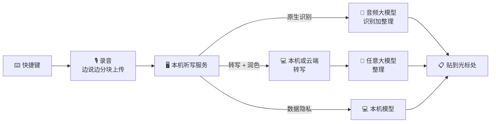

<p align="center">
  
</p>

<h1 align="center">SpeakMore</h1>

<p align="center">
  <b>说话，别打字。</b><br>
  免费开源的语音输入，Mac 和 Windows 都支持。<br>
  模型任你接，也可以全部留在本机。<br>
  <a href="https://speakmore.zephyrxiang.com/?lang=zh-CN">speakmore.zephyrxiang.com</a>
</p>

<p align="center">
  
  
  
  <a href="LICENSE"></a>
</p>

<p align="center">
  <a href="README.md">English</a> · <b>简体中文</b>
</p>

<p align="center">
  
</p>

<picture>
  <source media="(prefers-color-scheme: dark)" srcset="https://media.speakmore.zephyrxiang.com/readme/home-dark.zh-CN.ded4c77a.webp" />
  
</picture>

按一下，说话，再按一下：文字直接贴进光标所在的地方。用原生识别或转写 + 润色时，口头禅、说错重来、重复都会去掉，补好标点，长段落自动分段、分条。

## 五个自由

<table>
  <tr>
    <td align="center">🧩</td>
    <td><a href="#-模型自由"><b>模型自由</b></a></td>
    <td>29 个模型：Gemini、OpenAI、通义千问、DeepSeek、Kimi、智谱 GLM、MiniMax，以及任何 OpenAI 兼容服务。手里有哪家的密钥，就用哪家。</td>
  </tr>
  <tr>
    <td align="center">🔀</td>
    <td><a href="#-方式自由"><b>方式自由</b></a></td>
    <td>三种识别方式平级可选：原生识别、转写 + 润色、数据隐私。推荐组合一键切换。</td>
  </tr>
  <tr>
    <td align="center">💻</td>
    <td><a href="#-硬件自由"><b>硬件自由</b></a></td>
    <td>Apple 芯片和 Intel 的 Mac，以及 Windows。本机模型走 Metal、Vulkan（NVIDIA、AMD、Intel 显卡），没有显卡就用 CPU。</td>
  </tr>
  <tr>
    <td align="center">🔒</td>
    <td><a href="#-隐私自由"><b>隐私自由</b></a></td>
    <td>数据隐私方式只在本机转写，不上传任何数据。无需密钥，无需账号，模型一键下载。</td>
  </tr>
  <tr>
    <td align="center">💸</td>
    <td><a href="#-花钱自由"><b>花钱自由</b></a></td>
    <td>软件免费，按用量直接付给模型厂商。每天 100 次，推荐组合每月 ¥0 到约 ¥35。</td>
  </tr>
</table>

## 🚀 开始用

<p align="center">
  <a href="https://dl.zephyrxiang.com/speakmore/v0.9.0/SpeakMore-arm64.dmg"></a>
  <a href="https://dl.zephyrxiang.com/speakmore/v0.9.0/SpeakMore-x64.dmg"></a>
  <a href="https://dl.zephyrxiang.com/speakmore/v0.9.0/SpeakMore-Setup-x64.exe"></a>
</p>

| | 系统要求 | 安装 |
| --- | --- | --- |
| **Mac** | macOS 12 及以上 | 打开 dmg，把 SpeakMore 拖进"应用程序"。已用 Developer ID 签名并经 Apple 公证。 |
| **Windows** | Windows 10（1809 及以上）或 11，64 位 | 双击安装程序。若出现"Windows 已保护你的电脑"，点**更多信息 → 仍要运行**。只装在当前账户下，无需管理员权限，安装时无需联网。 |

习惯用终端的话，一行装好，另带 `speakmore` 命令：

```bash
# macOS
curl -fsSL https://dl.zephyrxiang.com/speakmore/install.sh | bash
```

```powershell
# Windows（PowerShell）
irm https://dl.zephyrxiang.com/speakmore/install.ps1 | iex
```

校验下载：在链接后面加 `.sha256` 即可拿到校验值。

<details>
<summary><b>下载安装还是终端安装？</b></summary>

下载的是独立的 App：macOS 的权限归 SpeakMore，可以开机自启。终端安装在 macOS 上从终端运行，权限归那个终端。Windows 上两种装的是同一份，都在 `%USERPROFILE%\.speakmore`，并加进开始菜单。两种共用设置、历史和 `speakmore` 命令，同一时间开一个即可。

</details>

## 🎙️ 怎么用

1. 点进任意输入框，按一下**右 Option**（Windows 是**右 Alt**）。
2. 说话。屏幕下方的悬浮条跟着声音跳动。
3. 再按一下，文字贴进光标处。按 `esc` 放弃这一段。

SpeakMore 在菜单栏里（Windows 在任务栏通知区域）。主窗口里有统计、历史、模型和设置。

### 首次引导

第一次打开时一步步带你配好。每一步都能前进、后退，也都能跳过，进去之后再配。数据隐私方式完全不需要密钥。

<table>
  <tr>
    <td width="50%"></td>
    <td width="50%"></td>
  </tr>
  <tr>
    <td align="center"><sub><b>1</b> · 选识别方式</sub></td>
    <td align="center"><sub><b>2</b> · 填密钥，也可以先跳过</sub></td>
  </tr>
  <tr>
    <td></td>
    <td></td>
  </tr>
  <tr>
    <td align="center"><sub><b>3</b> · 或者下载本机模型，后台进行</sub></td>
    <td align="center"><sub><b>4</b> · 开权限</sub></td>
  </tr>
  <tr>
    <td></td>
    <td></td>
  </tr>
  <tr>
    <td align="center"><sub><b>5</b> · 测麦克风</sub></td>
    <td align="center"><sub><b>6</b> · 测快捷键</sub></td>
  </tr>
  <tr>
    <td></td>
    <td></td>
  </tr>
  <tr>
    <td align="center"><sub><b>7</b> · 真说一句试试</sub></td>
    <td align="center"><sub><b>8</b> · 完成</sub></td>
  </tr>
</table>

## 🧩 模型自由

<picture>
  <source media="(prefers-color-scheme: dark)" srcset="https://media.speakmore.zephyrxiang.com/readme/vendors-dark.zh-CN.4bf2ba43.webp" />
  
</picture>

<sub>以上名称和标志归各自所有者，仅用来说明 SpeakMore 能对接哪些服务。</sub>

主窗口的**模型**页按角色列出所有模型：**原生 7 个**（音频进、文字出）、**转写 10 个**（本机 4 个、云端 6 个）、**润色 12 个**，标着官方价格和实测分数。同一个模型几家平台都在卖时只占一行，渠道自己选。

密钥按平台存，手里已有的那把就够用。一把阿里云百炼的密钥覆盖 14 个模型；DeepSeek、Kimi、智谱、MiniMax、Gemini、OpenAI 的官方密钥都能直接填；任何 OpenAI 兼容的服务，填上地址和密钥即可接入。

<table>
  <tr>
    <td width="50%"></td>
    <td width="50%"></td>
  </tr>
  <tr>
    <td align="center"><sub>所有模型、所有渠道</sub></td>
    <td align="center"><sub>一个平台一把密钥</sub></td>
  </tr>
</table>

## 🔀 方式自由

把声音变成文字有三种方式。每种方式各自记着自己的模型，来回切换不用重配。

| 方式 | 怎么走 | 什么会离开你的电脑 | 密钥 |
| --- | --- | --- | --- |
| ✨ **原生识别** | 录音 → Gemini、OpenAI 或通义千问 Omni → 成稿，一次请求 | 录音，只发给你选的厂商 | 一把 |
| 🪄 **转写 + 润色** | 录音 → 本机或云端转写 → 任意大模型润色 | 用本机转写时，只有文字 | 一把 |
| 🛡️ **数据隐私** | 录音 → 本机模型 → 文字 | 什么都不上传 | 不需要 |

<table>
  <tr>
    <td width="50%"></td>
    <td width="50%"></td>
  </tr>
  <tr>
    <td align="center"><sub>在首页切换识别方式</sub></td>
    <td align="center"><sub>推荐组合，一键启用</sub></td>
  </tr>
</table>

**推荐组合**把一整条路线打包好，可以先检测，再一键启用；缺的密钥、没下的模型就地补上。

| 组合 | 路线 | 每月¹ |
| --- | --- | --- |
| 本机转写 + DeepSeek | 本机 Qwen3-ASR 0.6B → DeepSeek V4.1 Flash | **约 ¥2.63** |
| Gemini 原生识别 | Gemini 3.6 Flash | 约 ¥35.49 |
| 百炼全云端 | Qwen3 ASR Flash → DeepSeek V4.1 Flash，一把密钥 | 约 ¥20.24 |
| 纯本机 | Qwen3-ASR 0.6B，不上传任何数据 | **¥0** |

<sub>¹ 每天 100 次、一个月 30 天，每次按一段典型口述算（26 秒，97 条真实口述的平均），按各家官方价格，美元按 6.71 折人民币。App 里显示的就是按价目表现算的这个数。Intel Mac 上的组合换成在 CPU 上跑的 SenseVoice Small。</sub>

## 💻 硬件自由

同一份本机模型在所有支持的机器上都能跑。有显卡就用显卡，不行自动退回 CPU。

| 机器 | 跑在 | Qwen3-ASR 0.6B，一段典型口述² |
| --- | --- | --- |
| Apple 芯片的 Mac | Metal | **231 毫秒**，68 倍实时 |
| 带显卡的 Windows（NVIDIA、AMD、Intel） | Vulkan | **240 毫秒**，73 倍实时（RTX 4060 Ti） |
| 任意 Mac 或 PC | CPU | SenseVoice Small：145 毫秒（Apple 芯片）· 463 毫秒（Core i5-13400F） |

<sub>² 97 条真实口述里转写一条的中位耗时，见下面的评测。</sub>


## 🔒 隐私自由

- **数据隐私方式什么都不上传。** 本机模型在你的电脑上把声音转成文字，无需密钥，无需账号。
- **一键下载，国内也快。** 模型从 SpeakMore 自己的国内源下载，下不动时自动换 Hugging Face，下完按 SHA-256 校验。默认的 850 MB 模型一分半钟左右下完。
- **哪种方式都没有中间商。** 没有 SpeakMore 的服务器，没有统计上报。录音或文字用你自己的密钥，直接发给你选的厂商。
- **密钥加密保存**，macOS 用钥匙串，Windows 用 DPAPI。历史和录音只存在本机。

<picture>
  <source media="(prefers-color-scheme: dark)" srcset="https://media.speakmore.zephyrxiang.com/readme/download-speed-dark.zh-CN.170a9ced.webp" />
  
</picture>

## 💸 花钱自由

SpeakMore 免费。你按用量直接付给模型厂商，每一分钱首页都看得到。下面按重度使用（每天 100 次）和 Typeless 的每一档对比：

| | 每月 | 每年 | 字数 | 声音发到哪 | 账号 |
| --- | --- | --- | --- | --- | --- |
| Typeless 免费版 | $0 | $0 | 每周有上限 | Typeless 的服务器³ | 必须注册 |
| Typeless Pro，按年付 | $12（约 ¥81） | $144（约 ¥966） | 不限 | Typeless 的服务器³ | 必须注册 |
| Typeless Pro，按月付 | $30（约 ¥201） | $360（约 ¥2,416） | 不限 | Typeless 的服务器³ | 必须注册 |
| Typeless 企业版 | 联系销售 | | 不限 | Typeless 的服务器³ | 必须注册，走 SSO |
| **SpeakMore · 纯本机** | **¥0** | **¥0** | 不限 | **留在你的电脑上** | **不需要** |
| **SpeakMore · 本机转写 + DeepSeek** | **约 ¥2.63** | **约 ¥32** | 不限 | 只有文字，发给 DeepSeek | **不需要** |
| **SpeakMore · 百炼全云端** | **约 ¥20.24** | **约 ¥243** | 不限 | 阿里云百炼 | **不需要** |
| **SpeakMore · Gemini 原生识别** | **约 ¥35.49** | **约 ¥426** | 不限 | Google | **不需要** |

<sub>Typeless 的价格取自 <a href="https://www.typeless.com/pricing">typeless.com/pricing</a>，2026-10-17 查。SpeakMore 的估算口径同上面的推荐组合，按 2026-10-17 的官方价格。Gemini 的免费密钥不花钱。<br>
³ 连同当前应用、窗口标题和屏幕上的文字一起（见<a href="targets/typeless/docs/06-context-capture-and-privacy.md">逆向笔记</a>）。</sub>

## 📊 评测

默认提示词用 60 条真实录音调过，每条都和 Typeless 对同一段录音的成品逐条对比。本机模型在 97 条真实口述上实测（共 42.5 分钟，中文、中英夹杂、英文都有），以原生识别的成品为参照，按固定的标准打 0–5 分。

<details>
<summary><b>本机转写：Apple 芯片和 Windows</b></summary>

| 模型 | Mac（Apple 芯片） | Windows（i5-13400F，RTX 4060 Ti） | 得分 | 体积 |
| --- | --- | --- | --- | --- |
| `qwen3-asr-0.6b-q8`（默认） | Metal · 231 毫秒 · 68 倍 | Vulkan · 240 毫秒 · 73 倍 | 4.14–4.16 | 850 MB |
| `sensevoice-small-q8` | Metal · 73 毫秒 · 226 倍 | Vulkan · 107 毫秒 · 186 倍 | 3.94 | 253 MB |
| `qwen3-asr-0.6b-int8` | CPU · 1081 毫秒 · 15 倍 | CPU · 3388 毫秒 · 5 倍 | 4.02–4.06 | 987 MB |
| `sensevoice-small-int8` | CPU · 145 毫秒 · 107 倍 | CPU · 463 毫秒 · 37 倍 | 3.75–3.78 | 237 MB |

耗时是每条口述的中位数，倍数是录音时长除以耗时。分语言看，Qwen3-ASR 中文 4.32、中英夹杂 4.02；SenseVoice 中文 4.38。完整数据：[Apple 芯片](bench/results/asr-round1-2026-10-16.md)、[Windows](bench/results/asr-windows-2026-10-17.md)。

</details>

<details>
<summary><b>端到端：Apple 芯片上的转写 + 润色</b></summary>

松开快捷键到文字上屏 **1.2–1.75 秒**，其中转写不到 0.7 秒，其余是润色那次请求。DeepSeek 润色一次约 $0.00004，提示词大半命中缓存。[实测记录](bench/results/e2e-local-2026-10-16.md)。

</details>

评测框架在 [`bench/`](bench/README.md)：加一个模型，只跑它那一列。

## ✅ 可信

- **开源**，MIT 许可。碰到你声音的每一行代码都看得到。
- **不要账号。** 不用注册，不用登录。
- **一个目录。** 数据、设置、密钥、模型、日志都在 `~/.speakmore`（Windows 是 `%USERPROFILE%\.speakmore`）。`speakmore uninstall` 一条命令全部删干净。
- **Mac 版签名并公证**，每个下载都附 SHA-256 校验值。
- **先逆向，再重写。** Typeless 的客户端拆解写成了 [18 篇笔记](targets/typeless/docs/00-overview.md)；SpeakMore 照它的交互从零写起，不含 Typeless 的任何代码和密钥。

## 🧑‍💻 开发者

- **App 能做的，命令行都能做。** 切方式、换模型、存密钥和检测、下载模型、看历史和花费。`status`、`history`、`usage` 加 `--json` 输出 JSON。
- **插件化。** 每家厂商都是同一接口后面的一个策略：录音统一成 16 kHz 单声道，转写统一返回 `{ text }`。
- **在 Mac 上开发 Windows 版。** [`scripts/dev/win-*.sh`](scripts/dev) 经 SSH 把工作区同步到 Windows 机器，在那边跑测试、从源码带调试端口重启 App、截整个桌面。
- **测试齐全。** 939 个单元测试、19 个安装测试，Biome 检查，界面的尺寸、字号和文案都有门禁。`npm run check` 一次跑完。

```bash
git clone https://github.com/zephyr4123/speakmore.git && cd speakmore
npm install
npm start          # 等同 speakmore 命令
npm run check      # lint 加全部测试
```



目录结构、打包、发版、每个版本实测过什么：见[开发说明](docs/development.md)和[实现笔记](docs/implementation-notes.md)。

## 📚 参考

<details>
<summary><b>⌨️ 命令</b></summary>

| 命令 | 做什么 |
| --- | --- |
| `speakmore` | 启动；已在运行就显示状态 |
| `speakmore stop` / `restart` | 停止 / 重启 |
| `speakmore status [--json]` | 是否在运行、密钥、权限、今天和累计的用量 |
| `speakmore update` | 升级到最新版，SpeakMore.app 一起换。设置、密钥、历史、录音都保留 |
| `speakmore history [-n 条数] [--json]` | 说过的话，最新的在前 |
| `speakmore usage [--json]` | 今天、本月、累计的花费、token 和回复耗时，按模型分 |
| `speakmore mode [native\|local\|private]` | 列出三种方式 / 当场切换。`local` 是转写 + 润色，`private` 是数据隐私 |
| `speakmore model [<厂商>[/<模型>]]` | 原生识别：各家（`gemini` / `openai` / `bailian`）和哪家有密钥 / 切换 |
| `speakmore transcriber [<模型>]` | 转写模型的体积、实测速度、下没下 / 切换 |
| `speakmore transcriber download\|cancel\|delete <模型>` | 管理本机模型 |
| `speakmore polish [<厂商>[/<模型>]] [--url <地址>]` | 润色模型：`deepseek` / `bailian` / `moonshot` / `zhipu` / `minimax` / `custom` |
| `speakmore model check`、`transcriber check`、`polish check` | 发一个最小的请求（或让系统语音读一句），看通不通、多快 |
| `speakmore key [<厂商>]` | 换密钥。可以从管道传：`pbpaste \| speakmore key`（Windows：`Get-Clipboard \| speakmore key`） |
| `speakmore key --forget [<厂商>]` | 删掉存着的密钥 |
| `speakmore config` / `config set <名> <值>` / `config unset <名>` | 看设置 / 直接改一项 / 恢复默认 |
| `speakmore theme [名]` | 列出主题 / 当场切换 |
| `speakmore settings` | 打开设置 |
| `speakmore logs [-n 行数] [-f]` | 看日志 |
| `speakmore uninstall [--keep-data]` | 卸载。先说要删什么，问过再删 |

</details>

<details>
<summary><b>⚙️ 设置项</b></summary>

| 名字 | 默认 | 可填 |
| --- | --- | --- |
| `hotkey` | `right_option`（macOS）、`right_alt`（Windows） | macOS：`right_option` / `right_command` / `right_control` / `fn`；Windows：`right_alt` / `right_ctrl` |
| `mode` | `native` | `native` / `local` / `private` |
| `model` | `gemini/gemini-3.6-flash` | 原生识别，`厂商/模型` |
| `thinking` | `MINIMAL` | Gemini 的思考档位：`MINIMAL` / `LOW` / `MEDIUM` / `HIGH` |
| `transcriber` | `qwen3-asr-0.6b-q8` | 转写 + 润色的第一步：本机模型，或云端的如 `bailian/qwen3-asr-flash` |
| `privateTranscriber` | `qwen3-asr-0.6b-q8` | 数据隐私用哪个本机模型 |
| `polish` | `deepseek/deepseek-flash` | 转写 + 润色的第二步，`厂商/模型`；自己的服务写 `custom/<模型>` |
| `customUrl` | 空 | 你的 OpenAI 兼容服务地址，如 `http://127.0.0.1:11434/v1` |
| `modelSource` | `cn` | 本机模型从哪下：`cn`（SpeakMore 国内源）/ `original`（Hugging Face） |
| `acceleration` | `auto` | `auto` 有显卡就用；`cpu` 只用 CPU |
| `barHint` | `on` | 悬浮条上方的操作提示：`on` / `off` |
| `theme` | `ink` | `ink` / `cinnabar` / `indigo` |
| `language` | `system` | `system` / `en` / `zh-CN` |

设置存在 `~/.speakmore/settings.json`。App 里、`speakmore mode`、`model`、`transcriber`、`polish` 都先检查再切换，当场生效；`config set` 直接写，不做检查。临时用一次，启动时带上 `SPEAKMORE_HOTKEY`、`SPEAKMORE_MODE`、`SPEAKMORE_MODEL`、`SPEAKMORE_TRANSCRIBER`、`SPEAKMORE_POLISH`、`SPEAKMORE_THEME`、`SPEAKMORE_LANGUAGE` 等；`GEMINI_API_KEY`、`OPENAI_API_KEY`、`DEEPSEEK_API_KEY`、`BAILIAN_API_KEY`、`MOONSHOT_API_KEY`（Kimi）、`ZHIPU_API_KEY`、`MINIMAX_API_KEY`、`SPEAKMORE_CUSTOM_API_KEY` 优先于存着的密钥。

</details>

<details>
<summary><b>💰 花费怎么算</b></summary>

每次调用模型都记一笔：token（含音频和思考）、模型、花费、耗时。首页按模型分今天、本月、累计；本机转写单独一行，不花钱。`speakmore usage` 更详细。

- 花费是按各家官方价格算的美元估算；按人民币标价的平台按 6.71 折算。
- Gemini 的提示词缓存让每次重复的那段提示词只收一成的钱；开口说话的那一刻 SpeakMore 就把缓存备好。

</details>

<details>
<summary><b>🔐 权限</b></summary>

| macOS 权限 | 用来 |
| --- | --- |
| 麦克风 | 录音 |
| 输入监控 | 听快捷键。只听那一个键，别的什么都不记 |
| 辅助功能 | 模拟 ⌘V 贴字；说话时接住 `esc` |

App 在首次引导里会请你开。终端安装时，权限归你运行它的那个终端。Windows 只需要麦克风权限（设置 › 隐私和安全性 › 麦克风）。

</details>

<details>
<summary><b>🗂️ 东西放在哪</b></summary>

全部在 `~/.speakmore/`（Windows 是 `%USERPROFILE%\.speakmore\`），只有你自己能读：

| 文件 | 说明 |
| --- | --- |
| `settings.json` | 设置 |
| `<厂商>-key.bin` | 加密的密钥，一家一个。解密用的钥匙在钥匙串里（Windows 由 DPAPI 绑定账户），文件拷走了也打不开 |
| `data/history.db`、`data/Recordings/` | 说过的话、录音和花费记录 |
| `logs/main.log` | 只记长度、耗时和用量，不记你说的话，不记密钥 |
| `models/` | 本机模型，你要了才下，下完按 SHA-256 校验 |
| `bin/`、`app/`、`runtime/` | 终端安装的程序本身 |

目录之外：钥匙串里的一项、你开过的权限、"应用程序"里的 SpeakMore；Windows 上还有开始菜单的快捷方式、Path 里的一项和开机自启的那一项。

</details>

<details>
<summary><b>🩺 排查</b></summary>

| 看到 | 这样做 |
| --- | --- |
| 密钥显示"还没验证" | 启动时没连上厂商，先用存着的密钥。联网后运行 `speakmore status` |
| 检测不通过，但密钥没错 | 多半是模型名或思考档位。`speakmore model check` 能看到回话；`speakmore config unset model` 恢复默认 |
| 按快捷键没反应 | `speakmore status` 会说缺什么；`speakmore restart` 重启听键的小帮手 |
| 命令说"5 秒内没有回应" | `speakmore stop`，再运行 `speakmore` |
| 菜单栏没有图标 | 刘海屏的 MacBook 上多出来的图标会藏到刘海后面。按住 ⌘ 把一些图标拖出菜单栏，或者用 `speakmore settings` |

</details>

<details>
<summary><b>🔄 升级和卸载</b></summary>

- **升级**：`speakmore update` 同时升级终端安装和 SpeakMore.app，并重新打开原来在运行的那个。只装了 App 的，下载新的 dmg 再拖一次。设置、密钥、历史、录音都保留。
- **卸载**：`speakmore uninstall` 停掉 SpeakMore，删掉整个目录、命令和钥匙串里的那一项（Windows 上还有 Path、开始菜单和开机自启）。加 `--keep-data` 保留设置、密钥、历史和录音。只装了 App 的，从菜单栏退出，再把它拖进废纸篓。

</details>

## 许可

[MIT](LICENSE)。`.claude/skills/` 下的文件来自 [REA](https://github.com/morluto/rea)，按它自己的 MIT 许可。

名字是向 Typeless 致意。SpeakMore 是依据逆向笔记独立实现的，与 Typeless 无关联。
