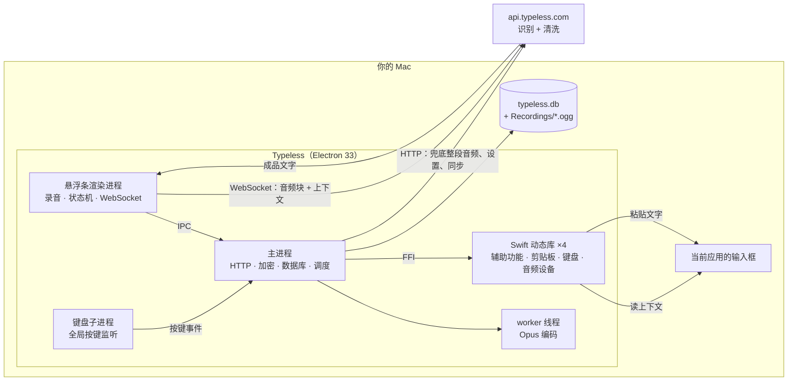

# 00 总览

## 一句话

Typeless 的客户端很薄：它负责录音、压缩、收集"你正在哪个输入框里打字"的上下文，然后把声音和上下文一起交给服务端；识别和文字清洗全部在服务端完成，客户端拿回成品文字后用"写剪贴板 + 模拟 ⌘V"贴进当前应用。

所以"转写清洗牛"的原因不在这个安装包里，在服务端的模型和提示词，客户端里看不到。客户端能看到的是它**喂给服务端什么**和**怎么做到快**。

## 它为什么快

1. **边说边传**。录音时每 3 秒切一块，压成 Opus，经一条常驻的 WebSocket 连接实时发给服务端。你松开按键时，服务端已经拿到了大部分音频。
2. **两条路赛跑**。结束时客户端同时准备一份完整音频走普通 HTTP 接口作兜底；WebSocket 先回就用它并取消 HTTP，网络差时直接改走 HTTP。
3. **上下文分两次给**。开始录音时先发一份轻量上下文（当前应用、输入框、光标前后文字），较重的那份（屏幕可见文字、输入框周围内容）在录音过程中补发，不占用结束后的等待时间。
4. **音频很小**。16 kHz 单声道、32 kbps 的 Opus，本机 3120 条录音合计 25 小时只有 253 MB。

## 架构

## 一次听写发出去的东西

| 内容 | 说明 |
| --- | --- |
| 音频 | Opus/Ogg，16 kHz 单声道 |
| 当前应用 | 名称、bundle id、窗口标题、窗口位置、进程号、应用路径；浏览器还有网页标题、网址、域名 |
| 输入框 | 类型、辅助功能角色、屏幕位置、是否可编辑、DOM id 和 class |
| 光标状态 | 光标位置、选中的文字、**光标前文字、光标后文字、整个输入框内容** |
| 输入框周围 | 输入框之前和之后各约 1000 字符的内容（黑名单应用/网址不采） |
| 屏幕可见文字 | 当前窗口可见文字，上限约 10000 字符（黑名单应用/网址不采） |
| 设备环境 | 系统信息（字段未逐一展开） |

上下文在发出前用服务端下发的 RSA 公钥加密，本机数据库里存的也是这份密文，本地读不回明文。详见 [06](06-context-capture-and-privacy.md)。

## 四个值得知道的行为

- **文字贴进去之后它还会看一会儿**。插入后约 15 秒内（期间你每改一次就重新计时），它每秒读一次那个输入框的内容，判断你有没有手动改它给的文字；结束时把"它给的原文、改之前的输入框内容、改之后的输入框内容、当前应用信息"发到 `/user/traits`。服务端可能据此自动往你的个人词典里加词。见 [06](06-context-capture-and-privacy.md#插入后的修改跟踪)。
- **每秒一次的焦点轮询是常开的**。应用启动后就以 1 秒间隔读取"当前应用 + 当前输入框"的基本信息。平时这份轮询不读文字内容，只在上面的修改跟踪期间才带上输入框文字。
- **它看得见你敲的每个键名**。全局按键监听把当前按住的键都传回应用，用于快捷键判定、修改跟踪，以及统计你最近一分钟敲了多少键来提示"试试语音"。读过的代码里这些只在内存里用，没有上传。见 [10](10-interaction-state-machine.md)。
- **黑名单只挡一部分**。微信、Excel、WPS、Sublime Text、Zed 在内置黑名单里，谷歌文档和腾讯文档按网址前缀在黑名单里。被挡的是"屏幕可见文字"和"输入框周围内容"；从代码看，光标前后文字和输入框全文不受黑名单影响（待抓包确认）。

## 对自己搓一个的启示

- 客户端的全部难点在三件事：全局热键、读焦点上下文、向任意应用注入文字。这三件在原生库里各对应一组很标准的系统 API，见 [07](07-native-helpers.md)。
- 服务端接口面很小：一条 WebSocket 加一个 HTTP 接口就是主链路，见 [05](05-network-protocol.md)。
- 客户端留了一个开发开关 `__DEV_API_HOST`，能把所有请求改指向任意主机。这既是我们抓包的入口，也意味着原版客户端可以直接对接自建服务端做对照实验。

## 证据的可信程度

- 包结构、签名、接口表、原生库用到的系统 API：直接从发行包读出，可靠。
- 主链路的行为描述：来自还原后的代码，是静态阅读的结论，没有在运行中验证。标了"待抓包确认"的地方尤其如此。
- 服务端做了什么：不知道。
